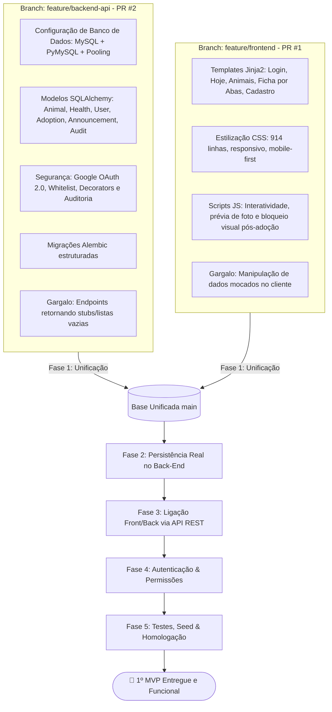
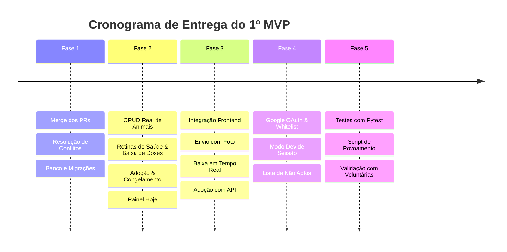

# 📋 Plano Detalhado de Finalização do 1º MVP — GAPAR Gestão

> **Plataforma de Controle de Abrigo e Saúde Animal — ONG GAPAR**  
> **Versão da Especificação:** 4.0 Consolidada (Padrão ISO/IEC/IEEE 29148:2018)  
> **Data:** Novembro de 2026  
> **Status:** Pronto para Execução  

---

## 🎯 1. Visão Geral e Objetivo do MVP

O objetivo deste plano é guiar a equipe na transição entre o estágio atual de desenvolvimento (dividido entre uma camada de interface com dados mockados e uma API REST em estruturação) e a entrega de um **1º Produto Mínimo Viável (MVP) 100% integrado, funcional e persistente**, apto para uso pelas voluntárias em campo e pela administradora do abrigo.

### 📌 Escopo Central do 1º MVP
1. **Autenticação & Controle de Acesso:** Login com Google OAuth 2.0 e validação de permissão via Whitelist (**RN12/RN14**).
2. **Módulo de Animais (Catálogo e Ficha):** Cadastro com foto comprimida (**RNF02**), listagem com busca/filtros, ficha completa dividida em abas e ciclo de vida do animal com máquina de estados operacionais (**RN01, RN02, RN03**).
3. **Módulo de Saúde & Farmácia:** Cartão de vacinas digital (**RF13**), prontuário médico (**RF14**), prescrição e baixa diária de doses com prevenção de duplicidade (**RF16**).
4. **Módulo de Adoção Responsável:** Registro formal de adotante (**RN04**), checagem contra a Lista Sigilosa de Não Aptos (**RN15**) e congelamento histórico do cão (**RN05**).
5. **Painel Operacional ("Hoje"):** Visão consolidada de tarefas, medicações e vacinas a serem administradas na data corrente (**RF23**).
6. **Mural de Avisos & Passagem de Turno:** Comunicação da diretoria e recados entre turnos de voluntárias.

---

## 🧩 2. Diagnóstico das Branches Atuais

---

## 🗺️ 3. Fases de Implementação

---

### 🟢 FASE 1: Unificação da Base de Código (Merge e Setup)
**Objetivo:** Consolidar os Pull Requests #1 (`feature/frontend`) e #2 (`feature/backend-api`) na branch principal, resolvendo inconsistências estruturais para que backend e frontend coexistam sem sobreposição.

#### 📝 Checklist de Tarefas:
- [ ] **1.1. Merge e Resolução de Conflitos**:
  - Unificar as duas ramificações na `main` (ou em `integration/mvp-1`).
  - Em `app/__init__.py`: manter o registro de todos os blueprints (`auth`, `core`, `animals`, `health`, `adoptions`, `admin`, `avisos`), o middleware de whitelist per-request e o carregamento dos templates e static.
  - Em `app/blueprints/core/routes.py`: manter as rotas que servem as páginas HTML (`/animais`, `/animais/novo`, `/animais/<id>`, `/hoje`, `/entrar`), mas remover dicionários e listas estáticas (`animais_exemplo`).
  - Em `app/config.py`: manter a configuração robusta de conexão com banco de dados MySQL via PyMySQL, variáveis de ambiente e pooling.
- [ ] **1.2. Banco de Dados e Migrações**:
  - Verificar e aplicar as migrações existentes (`flask db upgrade`).
  - Assegurar a existência das tabelas: `users`, `animals`, `vaccinations`, `medical_records`, `prescriptions`, `medication_logs`, `adoptions`, `non_eligible_people`, `announcements`, `announcement_acks`, `audit_logs`.
- [ ] **1.3. Validação do Ambiente**:
  - Confirmar inicialização limpa com `python run.py`.

---

### 🟢 FASE 2: Persistência Real e Regras de Negócio no Back-End
**Objetivo:** Substituir as respostas simuladas da API por operações reais com SQLAlchemy, aplicando com rigor as Regras de Negócio (RN01 a RN16).

#### 📝 Checklist de Tarefas:
- [ ] **2.1. Módulo de Animais (`/api/animais`)**:
  - `GET /api/animais`: Consulta real com filtros dinâmicos (`busca` por nome, `status_operacional`, `porte`, `sexo`, `is_castrado`, `is_idoso`) e paginação. Ocultar registros com `is_deleted = True` (**RN03**).
  - `POST /api/animais`: Cadastro salvando no banco. Forçar obrigatoriamente `status_operacional = "em acolhimento"` e `data_entrada = date.today()` (**RN01**).
  - Upload e compressão de fotos: Integrar rotina com Pillow para redimensionamento e salvamento de imagem com tamanho `< 300 KB` (**RNF02**).
  - `GET /api/animais/<id>`: Retornar payload completo com dados biométricos, lista de vacinas, prescrições e histórico de atendimentos.
  - `PATCH /api/animais/<id>`: Atualização cadastral com validação de status: bloquear qualquer edição se o animal estiver com status `adotado` ou `óbito` (**RN05**).
  - `PATCH /api/animais/<id>/status`: Máquina de transição de status operacional permitida apenas para administradoras (**RN02**).
  - `DELETE /api/animais/<id>`: Implementar exclusivamente exclusão lógica (`animal.is_deleted = True`), proibindo `db.session.delete()` (**RN03**).
- [ ] **2.2. Módulo de Saúde & Farmácia (`/api/saude`)**:
  - `POST /api/saude/prescricoes`: Criação de prescrição com início, término, medicamento, dosagem e intervalo de horas. Bloquear se o animal estiver congelado (**RN05**).
  - `POST /api/saude/prescricoes/<id>/baixa`: Registro de aplicação de dose em `MedicationLog` com identificador da voluntária logada, data e hora. Impedir registro duplicado no mesmo horário programado no dia (**RF16**).
  - `POST /api/saude/vacinas`: Cadastro de vacina aplicada e agendamento da data do próximo reforço (**RF13**).
  - `POST /api/saude/prontuarios`: Registro de consulta, curativo ou procedimento cirúrgico com bloqueio pós-adoção (**RF14, RN05**).
- [ ] **2.3. Módulo de Adoção (`/api/adocoes`)**:
  - `POST /api/adocoes`:
    1. Validar preenchimento obrigatório de Nome, Telefone, CPF e Data (**RN04**).
    2. Consultar o CPF e Telefone informado na tabela `non_eligible_people` (**RN15**). Se constar na lista, barrar a adoção com erro HTTP 400/422.
    3. Atualizar atomicamente o status do animal para `adotado`.
    4. Congelar o animal para futuras alterações cadastrais ou médicas (**RN05**).
    5. Registrar o evento na trilha de auditoria (`AuditLog`) com dados do usuário executor (**RN16**).
- [ ] **2.4. Painel Operacional Hoje (`/api/hoje`)**:
  - `GET /api/hoje`: Buscar e consolidar:
    - Todas as doses de medicamentos pendentes na data atual (`date.today()`).
    - Todas as vacinas com vencimento previsto para hoje ou em atraso.
    - Contadores e KPIs rápidos para o turno.
- [ ] **2.5. Mural de Avisos (`/api/avisos`)**:
  - `GET /api/avisos`: Listar comunicados da diretoria e recados do turno ordenados por data decrescente.
  - `POST /api/avisos`: Publicação de recado com categoria (`Saúde`, `Alimentação`, `Limpeza`, `Geral`).

---

### 🟢 FASE 3: Integração Front-End $\leftrightarrow$ Back-End (Remoção dos Mocks)
**Objetivo:** Conectar a interface Jinja2 e os arquivos JavaScript às rotas REST reais do Flask.

#### 📝 Checklist de Tarefas:
- [ ] **3.1. Listagem de Animais (`app/static/js/animais.js`)**:
  - Substituir a filtragem local estática por requisição assíncrona `fetch('/api/animais?...')`.
  - Renderizar os cards dinamicamente a partir da resposta JSON do backend, incluindo badges de status, porte e flags de castração/idoso.
- [ ] **3.2. Cadastro de Animal (`app/static/js/animal_formulario.js`)**:
  - Enviar dados via `FormData` para `POST /api/animais`, suportando o arquivo de imagem selecionado.
  - Tratar retornos de sucesso com redirecionamento para a ficha do animal recém-criado (`/animais/<id>`).
- [ ] **3.3. Ficha do Animal & Abas de Saúde (`animal_ficha.js`, `animal_saude.js`, `animal_medicacoes.js`)**:
  - Ajustar a rota Flask `/animais/<id>` para buscar o animal real no banco via SQLAlchemy (retornando 404 se não existir).
  - Atualizar o script de medicações para disparar `fetch('/api/saude/prescricoes/<id>/baixa', { method: 'POST' })` ao clicar no botão "Dar Baixa".
  - Atualizar o script de vacinas e prontuários para persistir os registros no backend.
  - Reforçar no frontend a desativação de todos os botões e formulários caso o animal esteja congelado (`status_operacional in ['adotado', 'óbito']`), alinhado à **RN05**.
- [ ] **3.4. Fluxo de Adoção (`app/static/js/animal_adocao.js`)**:
  - Enviar requisição para `POST /api/adocoes`.
  - Exibir alerta visual amigável caso a pessoa esteja na lista de não aptos ("Não foi possível prosseguir com esta adoção. Verifique com a administração").
  - Atualizar a interface em tempo real bloqueando as demais abas após a adoção ser confirmada.
- [ ] **3.5. Painel Diário (`app/static/js/hoje.js`)**:
  - Consumir `GET /api/hoje` e preencher os blocos de tarefas com as doses reais e pendências do abrigo.

---

### 🟢 FASE 4: Autenticação, Whitelist e Painel Administrativo
**Objetivo:** Garantir a segurança do sistema e a separação dos perfis de acesso (Administradora vs. Voluntária).

#### 📝 Checklist de Tarefas:
- [ ] **4.1. Configuração do Google OAuth 2.0**:
  - Preencher variáveis no `.env` (`GOOGLE_CLIENT_ID`, `GOOGLE_CLIENT_SECRET`).
  - Disponibilizar um mecanismo de autenticação para desenvolvimento local (ex: botão de login rápido com e-mail de teste cadastrado na Whitelist) para que a equipe e as voluntárias possam testar mesmo sem o console do Google Cloud configurado em cada máquina.
- [ ] **4.2. Gestão da Whitelist e Lista Sigilosa (`/api/admin`)**:
  - Garantir que a rota de cadastro e status de usuárias na Whitelist esteja restrita ao perfil `Administradora`.
  - Proteger a tabela `non_eligible_people` (**RN15**) com o decorator `@admin_required`, retornando HTTP 403 Forbidden para voluntárias comuns.
- [ ] **4.3. Auditoria Inviolável (`AuditLog`)**:
  - Assegurar que ações críticas (login, cadastro de animal, baixa de medicação, adoção, alteração de status) chamem `log_audit_event()` registrando timestamp, usuária e IP (**RN16**).

---

### 🟢 FASE 5: Testes Automatizados, Povoamento (Seed) e Homologação
**Objetivo:** Validar todas as regras de negócio em suíte de testes automatizados e preparar a aplicação para demonstração e uso das voluntárias.

#### 📝 Checklist de Tarefas:
- [ ] **5.1. Suíte de Testes Automatizados (`pytest`)**:
  - `tests/test_animals.py`:
    - Validar que novo animal recebe status `em acolhimento` e data de entrada do dia (**RN01**).
    - Validar que exclusão física é rejeitada e soft delete funciona (**RN03**).
    - Validar que voluntária não pode alterar status para adotado/óbito diretamente (**RN02**).
  - `tests/test_health.py`:
    - Validar registro de vacinas e cálculo do próximo reforço.
    - Validar gravação de `MedicationLog` na baixa de dose.
    - Validar bloqueio de baixa duplicada no mesmo horário no mesmo dia.
  - `tests/test_adoptions.py`:
    - Validar bloqueio de adoção caso CPF/Telefone conste em `non_eligible_people` (**RN15**).
    - Validar transição de status para `adotado`.
    - Validar congelamento imediato: tentativas de atualizar dados cadastrais ou registrar novos tratamentos devem retornar erro 403/422 (**RN05**).
  - `tests/test_auth.py`:
    - Validar bloqueio de login para e-mails fora da Whitelist (**RN12**).
    - Validar que usuária desativada tem sessão invalidada no request seguinte (**RN14**).
- [ ] **5.2. Comando de Povoamento Inicial (`seed`)**:
  - Criar comando CLI (`flask seed` ou `python run.py --seed`) que cria automaticamente:
    - 1 usuária Administradora de teste.
    - 2 voluntárias de teste na Whitelist.
    - 1 pessoa na Lista Sigilosa de Não Aptos (para testar o bloqueio de adoção).
    - 5 cães com dados completos (em acolhimento, em tratamento com medicações pendentes hoje, disponível para adoção, adotado com ficha congelada).
- [ ] **5.3. Homologação com as Voluntárias**:
  - Execução de roteiro de teste ponta a ponta:
    1. Login $\rightarrow$ Acessar Painel Hoje $\rightarrow$ Conferir doses pendentes.
    2. Cadastrar novo cão com foto $\rightarrow$ Conferir status "em acolhimento".
    3. Criar prescrição $\rightarrow$ Dar baixa na dose $\rightarrow$ Verificar atualização no Painel Hoje.
    4. Tentar adotar com pessoa bloqueada $\rightarrow$ Verificar rejeição.
    5. Concluir adoção regular $\rightarrow$ Verificar congelamento da ficha do animal.

---

## 🛡️ 4. Matriz de Validação das Regras de Negócio (RN)

| Identificador | Regra de Negócio | Onde é Validada | Status no MVP |
| :--- | :--- | :--- | :--- |
| **RN01** | Status inicial `'em acolhimento'` e data do dia no cadastro | Model `Animal` & `animals_bp` | ⏳ A integrar na Fase 2 |
| **RN02** | Máquina de estados operacionais controlada por permissão | `animals_bp` (apenas Admin altera status crítico) | ⏳ A integrar na Fase 2 |
| **RN03** | Proibição de exclusão física (Soft Delete obrigatório) | `animals_bp.delete_animal` (`is_deleted = True`) | ⏳ A integrar na Fase 2 |
| **RN04** | Adoção com Nome, Telefone, CPF e Data obrigatórios | `adoptions_bp.create_adoption` | ⏳ A integrar na Fase 2 |
| **RN05** | Congelamento de edições e tratamentos pós-adoção ou óbito | Model property `is_frozen`, decorators e JS | ⏳ A integrar na Fase 2 e 3 |
| **RN07** | Sinalização visual de idosos e cuidados especiais | Model `Animal` e badges nos templates | ✅ Implementado |
| **RN12** | Acesso fechado restrito a e-mails na Whitelist | `app/blueprints/auth/routes.py` | ✅ Backend pronto / A integrar telas |
| **RN14** | Revogação de acesso com efeito imediato na próxima requisição | Middleware `before_request` em `create_app` | ✅ Implementado |
| **RN15** | Sigilo total da Lista de Não Aptos contra voluntárias | Decorator `@admin_required` (HTTP 403) | ✅ Backend pronto / A integrar telas |
| **RN16** | Trilha inviolável de auditoria com IP, timestamp e usuária | `AuditLog` e helper `log_audit_event` | ✅ Implementado |
| **RNF02** | Compressão de imagens para `< 300 KB` no servidor | Utilitário Pillow em `animals_bp` | ⏳ A integrar na Fase 2 |

---

## 🏁 5. Critérios de Aceite para Entrega do 1º MVP (Definition of Done)

Para considerar o 1º MVP finalizado e pronto para produção/homologação, todos os itens abaixo devem ser atendidos:

1. [ ] Aplicação inicia sem erros via `python run.py`.
2. [ ] Banco de dados MySQL local ou remoto conectado com migrações atualizadas.
3. [ ] Fluxo de autenticação funcional com controle de Whitelist.
4. [ ] Cadastro de animal persiste no banco, redimensiona foto `< 300KB` e inicia em "em acolhimento".
5. [ ] Catálogo exibe animais do banco com busca por texto e filtros funcionando em tempo real.
6. [ ] Ficha do cão carrega dados reais do banco divididos em abas.
7. [ ] Prescrição de medicamento permite baixa de dose com um clique, gravando na trilha de auditoria.
8. [ ] Registro de adoção bloqueia adotantes na lista de não aptos e congela a ficha do animal após sucesso.
9. [ ] Painel "Hoje" reflete as tarefas reais da data.
10. [ ] Suíte de testes com `pytest` executando com 100% de sucesso nos cenários críticos.

