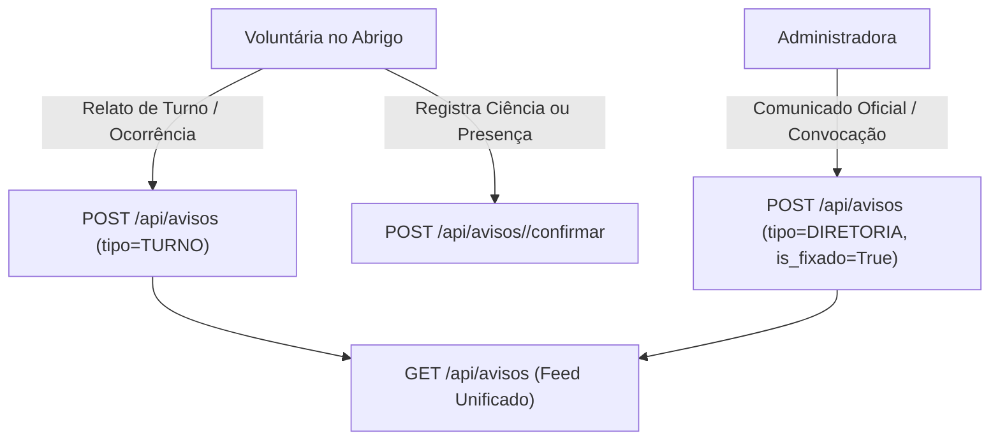

# 🛠️ Plano de Implementação do Back-End — GAPAR Gestão

> **Plataforma de Controle de Abrigo e Saúde Animal — ONG GAPAR**  
> **Escopo:** Exclusivo do **Back-End** (Python 3.12, Flask Blueprints, SQLAlchemy, PostgreSQL)  
> **Referência Normativa:** Padrão ISO/IEC/IEEE 29148:2018 (v4.0 Consolidada)  
> **Origem do Cronograma:** Quadro Trello Oficial `Back-end Gapar` (`002xWea2 - back-end-gapar.json`)  
> **Status Geral do Projeto:** 40 tarefas distribuídas em 4 Sprints + 10 Macro-tarefas temáticas de rastreabilidade  
> **Data de Atualização:** 27 de Outubro de 2026  

---

## 🧭 1. Visão Geral e Alinhamento com o Quadro Trello

O desenvolvimento do back-end do **GAPAR Gestão** foi inteiramente sincronizado com a estrutura do quadro Trello exportado. O projeto está organizado em:
1. **10 Macro-tarefas / Épicos ("A fazer"):** Estruturados por módulos de requisitos funcionais (RF), não-funcionais (RNF) e regras de negócio (RN).
2. **4 Sprints Executivas (40 tarefas atômicas):** Quebradas na ordem cronológica de dependência arquitetural:
   - **Sprint 1 (11 tarefas):** Infraestrutura Base, Autenticação Google OAuth 2.0, Whitelist e Auditoria Inicial.
   - **Sprint 2 (9 tarefas):** Módulo de Animais, Upload com Compressão de Imagens, Vacinação e Prontuário Clínico.
   - **Sprint 3 (13 tarefas):** Medicações, Baixas Diárias, Integração Google Agenda / ICS, Adoções e Imutabilidade.
   - **Sprint 4 (7 tarefas):** Inteligência Operacional ('Hoje'), Painel Administrativo, Auditoria Automática, Backups, Carga e Deploy PaaS.
3. **Módulo Operacional Complementar (Mural de Avisos):** Descoberto nos protótipos de tela (`Gapar_ADM` e `Gapar_VOLUN`) e integrado como extensão nativa do sistema.

---

## 🗺️ 2. Matriz de Rastreabilidade: Épicos do Trello ("A Fazer") ➔ Sprints & Requisitos

Esta matriz vincula diretamente os 10 cartões conceituais da lista **A Fazer** do Trello aos requisitos oficiais e às tarefas executivas das Sprints:

| # | Macro-tarefa no Trello ("A fazer") | Requisitos Vinculados | Tarefas Executivas da Sprint Correspondente |
| :-: | :--- | :--- | :--- |
| **01** | `1° Configuração do Ambiente e Arquitetura Base` | RNF01, RNF04 | **Sprint 1:** Tarefas 1, 2 e 3 |
| **02** | `2° Modelagem do Banco de Dados (Core Inicial)` | RNF05, RNF06, RN16 | **Sprint 1:** Tarefas 4, 5 e 6 |
| **03** | `3° Módulo de Autenticação e Segurança` | RF01, RF02, RF03, RNF05, RNF06, RNF07, RN12, RN13, RN14 | **Sprint 1:** Tarefas 7, 8, 9, 10 e 11 |
| **04** | `4° Modelagem do Banco de Dados (Animais e Saúde)` | RF05, RF13, RF14, RN01, RN07 | **Sprint 2:** Tarefas 1, 2 e 3 |
| **05** | `5° Endpoints de Cadastro e Gestão de Animais` | RF05, RF06, RF07, RF08, RF09, RF10, RF11, RNF02, RN01, RN03 | **Sprint 2:** Tarefas 4, 5, 6 e 7 |
| **06** | `6° Endpoints de Saúde e Vacinação` | RF13, RF14 | **Sprint 2:** Tarefas 8 e 9 |
| **07** | `7° Modelagem do Banco de Dados (Medicações e Adoções)` | RF15, RF16, RF20, RF22, RN04, RN15 | **Sprint 3:** Tarefas 1, 2, 3 e 4 |
| **08** | `8° Endpoints de Prescrição e Baixa de Medicações` | RF15, RF16, RN08, RN09 | **Sprint 3:** Tarefas 5, 6 e 7 |
| **09** | `9° Integração com Google Agenda e Exportação ICS` | RF17, RF18, RN10, RN11 | **Sprint 3:** Tarefas 8 e 9 |
| **10** | `10° Fluxo de Adoções e Regras de Imutabilidade` | RF19, RF20, RF21, RN02, RN03, RN04, RN05, RN06 | **Sprint 3:** Tarefas 10, 11, 12 e 13 |
| **—** | *Operações Consolidadas, Painel e Deploy* | RF23, RF04, RF24, RNF03, RNF08 | **Sprint 4:** Tarefas 1 a 7 |

---

## 🏃 3. Cronograma Executivo por Sprints (40 Tarefas Detalhadas)

> **Legenda de Status:**  
> - 🟢 **[CONCLUÍDO / ESTRUTURADO]:** Estrutura e modelos já implementados e validados.  
> - 🟡 **[PARCIAL / EM MOCK]:** Rota/arquivo criado, necessita de persistência real ou integração com banco.  
> - ⚪ **[PENDENTE]:** Aguardando início formal da implementação na sprint.

---

### 📦 SPRINT 1: Infraestrutura Base, Autenticação, Whitelist & Auditoria (11 Tarefas)

**Meta da Sprint:** Estabelecer o núcleo da aplicação Flask, persistência via SQLAlchemy, barramento de autenticação restrita via Google OAuth 2.0 e isolamento de privilégios.

| ID | Tarefa no Trello | Arquivos de Destino | Status | Critérios de Aceite & Implementação Técnica |
| :-: | :--- | :--- | :-: | :--- |
| **S1.01** | `1° Configurar o ambiente Python 3.12, Flask e Blueprints` | `app/__init__.py`, `run.py`, `wsgi.py` | 🟢 | Ambiente Python 3.12 isolado, Application Factory `create_app()` e registro dinâmico dos 7 Blueprints. |
| **S1.02** | `2° Configurar o gerenciador de dependências e variáveis de ambiente` | `requirements.txt`, `.env`, `app/config.py` | 🟢 | `python-dotenv` carregando credenciais de banco, segredos de criptografia e parâmetros OAuth em `Config`. |
| **S1.03** | `3° Configurar a conexão com o banco de dados via SQLAlchemy ORM` | `app/extensions.py`, `migrations/` | 🟢 | Inicialização do Flask-SQLAlchemy e Flask-Migrate com pool otimizado para PostgreSQL/SQLite local. |
| **S1.04** | `4° Criar a tabela users no banco de dados` | `app/models/user.py` | 🟢 | Tabela `users` com colunas `id`, `email`, `name`, `google_id`, `role` (`Administradora`/`Voluntaria`), `is_active` e timestamps. |
| **S1.05** | `5° Criar a tabela whitelist com regra para o primeiro e-mail Admin` | `app/models/user.py`, `app/models/whitelist.py` | 🟢 | Modelo para pré-aprovação de e-mails. Seed inicial garante o e-mail da Administradora mestre no deploy. |
| **S1.06** | `6° Criar a tabela audit_logs para trilha de auditoria` | `app/models/audit.py` | 🟢 | Tabela `audit_logs` registrando `user_id`, `user_email`, `acao`, `entidade`, `entidade_id`, `detalhes`, `ip_origem` e data. |
| **S1.07** | `7° Implementar a rota de autenticação via Google OAuth 2.0` | `app/blueprints/auth/routes.py` | 🟡 | Trocar mock atual por fluxo Authlib real: `POST /auth/google` (validação de JWT Google) e `/auth/callback`. |
| **S1.08** | `8° Desenvolver o middleware de validação de Whitelist` | `app/utils/decorators.py`, `app/__init__.py` | 🟡 | Decorator `@whitelist_required` e hook `before_request` que barram usuários inexistentes ou com `is_active=False` (HTTP 403). |
| **S1.09** | `9° Desenvolver o controle de acesso por rotas (Admin vs Voluntária)` | `app/utils/decorators.py` | 🟡 | Decorator `@admin_required` garantindo que voluntárias não acessem endpoints administrativos (HTTP 403). |
| **S1.10** | `10° Configurar criptografia de tokens da API Google no banco` | `app/utils/crypto.py`, `app/models/user.py` | ⚪ | Utilizar `cryptography.fernet` para cifrar e decifrar `google_access_token` e `google_refresh_token` em repouso (RNF08). |
| **S1.11** | `11° Garantir o bloqueio imediato de acesso ao desativar na whitelist` | `app/models/user.py` (`load_user`) | 🟢 | `@login_manager.user_loader` rejeita instantaneamente a sessão no request subsequente à alteração de `is_active=False` (RN14). |

---

### 🐾 SPRINT 2: Animais, Ficha, Vacinas & Prontuário (9 Tarefas)

**Meta da Sprint:** Permitir o ciclo completo de entrada de resgates, armazenamento econômico de fotos, acompanhamento vacinal e histórico clínico.

| ID | Tarefa no Trello | Arquivos de Destino | Status | Critérios de Aceite & Implementação Técnica |
| :-: | :--- | :--- | :-: | :--- |
| **S2.01** | `1° Criar a tabela animals com status iniciais e flags` | `app/models/animal.py` | 🟢 | Tabela `animals` com status, flags (`is_castrado`, `is_microchipado`, `is_idoso`), `localizacao_baia`, `codigo_identificador` e soft delete. |
| **S2.02** | `2° Criar a tabela vaccination_cards` | `app/models/health.py` | 🟢 | Tabela `vaccinations` com `animal_id`, `nome_vacina`, `lote`, `data_aplicacao`, `data_reforco` e `observacoes`. |
| **S2.03** | `3° Criar a tabela medical_records` | `app/models/health.py` | 🟢 | Tabela `medical_records` para consultas, cirurgias, exames, veterinário, clínica e diagnóstico. |
| **S2.04** | `4° Desenvolver endpoint de cadastro básico com estado inicial obrigatório` | `app/blueprints/animals/routes.py` | 🟡 | `POST /api/animais`: Persistência real forçando `status_operacional = 'em acolhimento'` e `data_entrada = date.today()` (RN01). |
| **S2.05** | `5° Implementar serviço de upload e compressão automática de fotos (<300KB)` | `app/utils/image_compressor.py`, `app/blueprints/animals/routes.py` | 🟡 | Processamento via Pillow: redimensionamento máx 1280px, conversão JPEG/WebP com qualidade otimizada para manter arquivo < 300KB (RNF02). |
| **S2.06** | `6° Implementar endpoints de listagem paginada e busca avançada` | `app/blueprints/animals/routes.py` | 🟡 | `GET /api/animais`: Query com paginação (`page`, `per_page`), busca por nome/código (ILIKE) e filtros por baia, sexo, porte e status (RF10, RF11). |
| **S2.07** | `7° Desenvolver endpoint de edição de dados cadastrais do animal` | `app/blueprints/animals/routes.py` | 🟡 | `PATCH /api/animais/<id>`: Atualização de atributos cadastrais. Bloqueia sumariamente se `animal.is_frozen` (RN05). |
| **S2.08** | `8° Desenvolver endpoints para registro e consulta de vacinação` | `app/blueprints/health/routes.py` | 🟡 | `GET/POST /api/saude/vacinas` e `GET /api/saude/vacinas/reforcos`: Persistência de doses aplicadas e alerta de reforços vencidos/a vencer (RF13). |
| **S2.09** | `9° Desenvolver endpoints para o prontuário de histórico médico` | `app/blueprints/health/routes.py` | 🟡 | `GET/POST /api/saude/prontuarios`: Inclusão de atendimentos clínicos com bloqueio caso o animal esteja congelado (RF14). |

---

### 💊 SPRINT 3: Medicações, Adoções, Google Calendar & Imutabilidade (13 Tarefas)

**Meta da Sprint:** Assegurar a administração rigorosa de remédios, lembretes de doses, formalização de adoções com validação sigilosa e imutabilidade histórica.

| ID | Tarefa no Trello | Arquivos de Destino | Status | Critérios de Aceite & Implementação Técnica |
| :-: | :--- | :--- | :-: | :--- |
| **S3.01** | `1° Criar a tabela medications` (Prescriptions) | `app/models/health.py` | 🟢 | Modelo `Prescription` com dosagem, horários diários, `data_inicio`, `data_fim` e flag calculada `is_active`. |
| **S3.02** | `2° Criar a tabela medication_logs` | `app/models/health.py` | 🟢 | Modelo `MedicationLog` registrando doses administradas com vínculo a `prescription_id`, `user_id`, data e horário exato. |
| **S3.03** | `3° Criar a tabela adoptions` | `app/models/adoption.py` | 🟢 | Modelo `Adoption` com nome, telefone, CPF, endereço, data da adoção e flag `termo_fisico_assinado`. |
| **S3.04** | `4° Criar a tabela restricted_adopters (Lista Sigilosa)` | `app/models/blacklist.py` | 🟢 | Modelo `NonEligiblePerson` contendo nomes, telefones, CPFs e motivos de impedimento (histórico de maus-tratos/negligência). |
| **S3.05** | `5° Validar regra de restrição de status para prescrição de remédios` | `app/blueprints/health/routes.py` | ⚪ | Rejeitar prescrição médica caso o cão esteja em status `adotado` ou `óbito` (RN05/RN08). |
| **S3.06** | `6° Implementar cálculo dinâmico da janela de validade da medicação` | `app/models/health.py`, `app/services/health_service.py` | 🟡 | Determinar status diário (`PENDENTE`, `MINISTRADA`, `ATRASADA`) com base nos horários previstos e tolerância de turno. |
| **S3.07** | `7° Desenvolver endpoint para baixa diária de medicação` | `app/blueprints/health/routes.py` | 🟡 | `POST /api/saude/prescricoes/<id>/baixa`: Cria registro em `MedicationLog`, impedindo baixas repetidas para o mesmo intervalo de horário (RF16). |
| **S3.08** | `8° Integrar com a Google Calendar API v3 para lembretes automáticos` | `app/services/google_calendar.py` | ⚪ | Criar/atualizar eventos de medicação no Google Calendar da voluntária vinculada ao turno quando uma prescrição for criada (RF17). |
| **S3.09** | `9° Implementar contingência para exportação de arquivo .ics` | `app/services/calendar_exporter.py` | 🟡 | Gerar arquivo iCalendar `.ics` válido (RFC 5545) contendo todas as doses do cão para importação em qualquer cliente de calendário offline (RF18). |
| **S3.10** | `10° Implementar máquina de estados para transição de status do animal` | `app/blueprints/animals/routes.py` | ⚪ | `PATCH /api/animais/<id>/status`: Transições controladas (ex: `em acolhimento` ➔ `em tratamento` ➔ `disponível`). Exclusivo da Administradora (RN02). |
| **S3.11** | `11° Criar validação obrigatória de dados do adotante para status adotado` | `app/blueprints/adoptions/routes.py` | 🟡 | Validação estrita de Nome, Telefone e Data (**RN04**). Checagem automática contra `non_eligible_people` (**RN15**). |
| **S3.12** | `12° Implementar congelamento de prontuários para animais adotados ou com óbito` | `app/utils/guards.py`, `app/models/animal.py` | ⚪ | Bloqueio automático via decorator ou listener que impede edições cadastrais e inclusão de prescrições/prontuários (RN05). |
| **S3.13** | `13° Proibir exclusão física de registros no banco de dados` | `app/blueprints/animals/routes.py` | 🟡 | `DELETE /api/animais/<id>`: Atribui `is_deleted = True` e remove dos resultados de listagem padrão (RN03). |

---

### 📊 SPRINT 4: Painel 'Hoje', Gestão Admin, Auditoria Automática & Deploy (7 Tarefas)

**Meta da Sprint:** Consolidar visão operacional diária diferenciada por papel, fechar ferramentas administrativas de auditoria, testar concorrência e realizar o deploy PaaS.

| ID | Tarefa no Trello | Arquivos de Destino | Status | Critérios de Aceite & Implementação Técnica |
| :-: | :--- | :--- | :-: | :--- |
| **S4.01** | `1° Desenvolver query otimizada para o painel operacional 'Hoje'` | `app/blueprints/core/routes.py` | 🟡 | `GET /api/hoje`: Query agregada em banco retornando doses pendentes no dia e reforços vacinais. Payload customizado para Administradora (KPIs gerais) e Voluntária (ações do plantão). |
| **S4.02** | `2° Desenvolver endpoints exclusivos da Admin para gestão da whitelist` | `app/blueprints/admin/routes.py` | 🟡 | `GET /api/admin/whitelist`, `POST /api/admin/whitelist` e `PATCH /api/admin/whitelist/<id>/status` para habilitar ou revogar acessos (RF04). |
| **S4.03** | `3° Desenvolver endpoints exclusivos da Admin para a Lista Sigilosa de não aptos` | `app/blueprints/admin/routes.py` | 🟡 | CRUD restrito à Administradora em `non_eligible_people`. Bloqueio estrito com HTTP 403 Forbidden para voluntárias (RF22, RN15). |
| **S4.04** | `4° Implementar listeners no SQLAlchemy para auditoria automática de alterações` | `app/utils/audit_listener.py` | ⚪ | Eventos `after_insert`, `after_update` e `after_delete` gravando automaticamente em `audit_logs` dados modificados, usuário e IP (RN16). |
| **S4.05** | `5° Configurar rotina de backup automatizado diário com retenção de 30 dias` | `scripts/backup_db.py`, cron/job | ⚪ | Script Python de dump do banco de dados com compressão e expurgo de arquivos com mais de 30 dias (RNF06). |
| **S4.06** | `6° Realizar testes de carga básicos para concorrência` | `tests/load_test.py` | ⚪ | Execução de testes de estresse (Locust/pytest concorrente) simulando múltiplas voluntárias registrando baixas simultâneas de medicação. |
| **S4.07** | `7° Realizar o deploy do back-end em plataforma PaaS gratuita` | `Dockerfile`, `render.yaml`, `Procfile` | ⚪ | Publicação em nuvem gratuita (Render / Fly.io / Railway) com banco gerenciado PostgreSQL e variáveis em conformidade com o `.env.example`. |

---

## 📢 4. Módulo Operacional: Mural de Avisos e Passagem de Turno

Identificado na prototipação das interfaces (`Gapar_ADM/Mural de Avisos e Turno.png` e `Gapar_VOLUN/`), este módulo já conta com suporte no modelo e rotas:



- **Modelo `Announcement` (`app/models/announcement.py`):** Suporta comunicados urgentes, fixados e relatos com tags (`Geral`, `Saude`, `Alimentacao`, `Limpeza`, `Logistica`, `Procedimento`).
- **Modelo `AnnouncementAck`:** Registra confirmação de presença em convocações ou marcação de "Ciente" em notas clínicas.

---

## 🔒 5. Matriz de Garantia das Regras de Negócio (RN01 a RN16)

| Regra | Descrição Sintética | Camada de Imposição no Código | Validação Automatizada (Pytest) |
| :--- | :--- | :--- | :--- |
| **RN01** | Status inicial `'em acolhimento'` e data de hoje | Construtor em `Animal` e validação no schema POST | `tests/test_animals.py::test_rn01_novo_animal_status_inicial` |
| **RN02** | Máquina de estados operacionais exclusiva da Admin | Rota `PATCH /api/animais/<id>/status` com `@admin_required` | `tests/test_animals.py::test_rn02_voluntaria_nao_muda_status` |
| **RN03** | Proibição de exclusão física (Soft Delete) | `animal.is_deleted = True` em vez de `session.delete()` | `tests/test_animals.py::test_rn03_soft_delete_preserva_registro` |
| **RN04** | Adoção com Nome, Telefone e Data obrigatórios | Validação estrita no payload de entrada da rota | `tests/test_adoptions.py::test_rn04_dados_adotante_obrigatorios` |
| **RN05** | Congelamento pós-adoção ou óbito | Hook/Guard que rejeita alterações cadastrais e médicas | `tests/test_adoptions.py::test_rn05_congelamento_pos_adocao` |
| **RN06** | Preservação perene de dados históricos | Restrição de integridade referencial sem cascade delete | `tests/test_adoptions.py::test_rn06_historico_imutavel` |
| **RN07** | Ficha padrão SRD e flags especiais | Default SRD e booleanos de castração e microchipagem | `tests/test_animals.py::test_rn07_valores_padrao_animal` |
| **RN08** | Prescrição vinculada a animal não congelado | Bloqueio de nova receita para cães adotados ou em óbito | `tests/test_health.py::test_rn08_prescricao_status_valido` |
| **RN09** | Janela de validade da prescrição médica | Propriedade `is_active` checando período de vigência | `tests/test_health.py::test_rn09_janela_validade_prescricao` |
| **RN10** | Lembretes de doses sincronizados com Google Calendar | Chamada ao serviço de eventos com token da usuária | `tests/test_calendar.py::test_rn10_geracao_evento_google` |
| **RN11** | Contingência com arquivo universal `.ics` | Rota `GET /api/saude/lembretes/<id>.ics` retornando RFC 5545 | `tests/test_calendar.py::test_rn11_exportacao_ics_valido` |
| **RN12** | Sistema fechado com Whitelist prévia | Rejeição de login no callback caso e-mail não esteja ativo | `tests/test_auth.py::test_rn12_login_bloqueado_fora_whitelist` |
| **RN13** | Perfis de acesso: Administradora vs. Voluntária | RBAC com rotas demarcadas por decorators específicos | `tests/test_auth.py::test_rn13_acesso_diferenciado_papeis` |
| **RN14** | Efeito imediato na revogação da Whitelist | Checagem a cada requisição em `user_loader` e session | `tests/test_auth.py::test_rn14_desativacao_imediata_whitelist` |
| **RN15** | Sigilo absoluto da Lista de Não Aptos | Rota de Não Aptos restrita exclusivamente à Administradora | `tests/test_admin.py::test_rn15_sigilo_lista_nao_aptos` |
| **RN16** | Trilha inviolável de auditoria | Listeners SQLAlchemy gravando em `audit_logs` sem bypass | `tests/test_audit.py::test_rn16_auditoria_imutavel_gravada` |

---

## 🧪 6. Arquitetura da Suíte de Testes Automatizados (Pytest)

Para garantir 100% de cobertura das regras acima, a suíte de testes em `tests/` será organizada em:

```
tests/
├── conftest.py                   # Fixtures: app de teste, banco em memória SQLite, cliente autenticado
├── test_auth.py                  # Validações de Login Google, Whitelist, Token Crypto e RN12, RN13, RN14
├── test_animals.py               # Cadastro básico, compressão de imagens, busca paginada e RN01, RN02, RN03
├── test_health.py                # Vacinas, prontuários, baixas diárias de doses e RN08, RN09
├── test_adoptions.py             # Registro de adoção, verificação na lista sigilosa e RN04, RN05, RN06
├── test_calendar.py              # Sincronização Google Calendar e exportação .ics (RN10, RN11)
├── test_admin.py                 # Gestão de whitelist, lista sigilosa e RN15
├── test_audit.py                 # Listeners de auditoria automática e integridade de logs (RN16)
└── test_load.py                  # Teste de concorrência básica para baixas simultâneas de doses
```

---

## 🚀 7. Roteiro Imediato de Implementação (Passo a Passo)

1. **Substituição dos Mocks da Sprint 1:**
   - Finalizar os decorators `@whitelist_required` e `@admin_required`.
   - Adicionar o utilitário de criptografia Fernet em `app/utils/crypto.py` para os tokens Google.
2. **Persistência Real das Rotas da Sprint 2:**
   - Substituir os payloads estáticos de `app/blueprints/animals/routes.py` por consultas reais via SQLAlchemy.
   - Criar utilitário `app/utils/image.py` com Pillow para redimensionamento e compressão automática de fotos `< 300KB`.
3. **Mecanismo de Baixa e Adoções da Sprint 3:**
   - Desenvolver endpoint de baixa de doses em `Prescription` com inserção em `MedicationLog` e trava contra duplicidades.
   - Implementar consulta à tabela `non_eligible_people` no momento do registro da adoção.
   - Criar o gerador `.ics` com a biblioteca `icalendar`.
4. **Agregação do Painel 'Hoje' e Deploy da Sprint 4:**
   - Implementar queries agregadas para a data do dia em `app/blueprints/core/routes.py`.
   - Configurar listeners SQLAlchemy para inserção em `audit_logs`.
   - Preparar arquivos de deploy (`Procfile`, `render.yaml`, `Dockerfile`).
