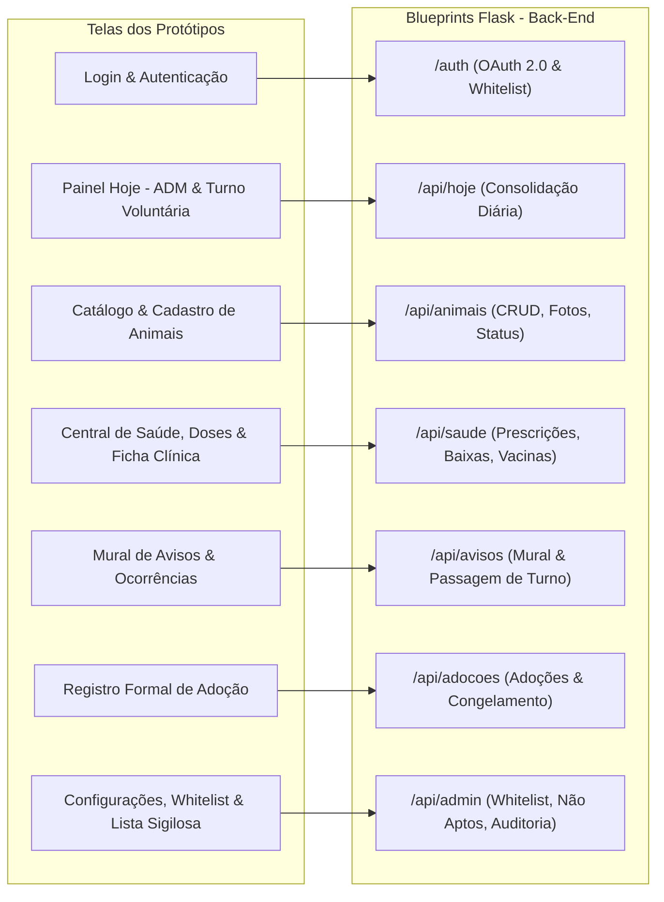

# 🛠️ Plano de Implementação do Back-End (API MVP) — GAPAR Gestão

> **Plataforma de Controle de Abrigo e Saúde Animal — ONG GAPAR**  
> **Escopo:** Exclusivo do **Back-End** (Python 3.12, Flask Blueprints, SQLAlchemy, PostgreSQL)  
> **Referência:** Padrão ISO/IEC/IEEE 29148:2018 (v4.0 Consolidada) e Protótipos de Interface ([`Gapar_ADM/`](Gapar_ADM/) e [`Gapar_VOLUN/`](Gapar_VOLUN/))  
> **Data:** 27 de Outubro de 2026  

---

## 🎯 1. Escopo e Objetivos do Back-End

O back-end do **GAPAR Gestão** é o motor de regras de negócio, persistência, auditoria e segurança da ONG. Sua responsabilidade é fornecer uma API REST robusta, determinística e segura para suportar integralmente as interfaces das voluntárias em campo e das administradoras do abrigo.

Os protótipos de interface contidos em `Gapar_ADM` e `Gapar_VOLUN` funcionam como a **especificação visual dos contratos de dados**: cada componente, badge, filtro e ação reflete uma regra de negócio ou endpoint que o back-end deve validar, processar e responder.

---

## 🧩 2. Mapeamento: Telas dos Protótipos ➔ Contratos de API do Back-End



---

## 🔍 3. Diagnóstico do Back-End Atual vs. Protótipos (Gap Analysis)

Ao confrontar o código existente em `app/` com os protótipos visuais, identificamos as seguintes demandas de evolução no back-end:

| Tela / Módulo dos Protótipos | Estado Atual do Back-End | O que Falta Implementar no Back-End |
| :--- | :--- | :--- |
| **Painel Hoje (ADM vs. Voluntária)** | Rota `/api/hoje` retorna dados genéricos do abrigo. | Diferenciar payload por papel (`Administradora` recebe KPIs globais; `Voluntaria` recebe pendências do turno corrente e plantão). |
| **Mural de Avisos & Turno** | *Inexistente no back-end.* | **Criar modelo `Announcement` e blueprint `/api/avisos`** com suporte a comunicados da diretoria, relatos do turno categorizados por tags (`Saúde`, `Logística`, `Procedimento`, etc.) e confirmações de presença/ciência. |
| **Triagem de Campo (Passo 1 e 2)** | Cadastro em `/api/animais` espera dados completos. | Permitir entrada com campos provisórios de resgate inicial sem quebrar a integridade (RN01: status `'em acolhimento'`). |
| **Upload de Fotos (< 300KB)** | Dependência `Pillow` presente em `requirements.txt`. | Implementar middleware/utilitário de redimensionamento e compressão automática server-side para fotos enviadas em campo (`RNF02`). |
| **Baixa Rápida de Doses** | Modelo `MedicationLog` existente. | Endpoint dedicado `POST /api/saude/prescricoes/<id>/baixa` que registra automaticamente o `user_id` da voluntária, hora e checa duplicidade de baixa no mesmo intervalo de dose. |
| **Adoção Responsável** | Modelo `Adoption` com congelamento existente. | Validação prévia contra a `non_eligible_people` e checagem de integridade (animal castrado, microchipado e vacinado). |
| **Lista Sigilosa de Não Aptos** | Modelo `NonEligiblePerson` existente. | Bloqueio rigoroso de endpoint no nível de decorator (`@admin_required`) garantindo isolamento total contra vazamento de dados (`RN15`). |

---

## 🗄️ 4. Estrutura de Dados e Extensões nos Modelos (SQLAlchemy)

### 4.1. Novo Modelo: `app/models/announcement.py` (Mural de Avisos)
Para suportar a tela `Mural de Avisos e Turno.png`:

```python
from datetime import datetime
from app.extensions import db

class Announcement(db.Model):
    """Comunicados oficiais da Diretoria e Relatos de Turno (Mural GAPAR)."""
    __tablename__ = "announcements"

    id = db.Column(db.Integer, primary_key=True)
    tipo = db.Column(db.String(20), nullable=False) # 'DIRETORIA' ou 'TURNO'
    titulo = db.Column(db.String(150), nullable=True) # Obrigatório para comunicados
    conteudo = db.Column(db.Text, nullable=False)
    categoria = db.Column(db.String(30), nullable=False, default="Geral") # 'Geral', 'Saude', 'Alimentacao', 'Limpeza', 'Logistica', 'Procedimento'
    is_urgente = db.Column(db.Boolean, default=False, nullable=False)
    is_fixado = db.Column(db.Boolean, default=False, nullable=False)
    
    # Relações
    autor_id = db.Column(db.Integer, db.ForeignKey("users.id"), nullable=False)
    animal_id = db.Column(db.Integer, db.ForeignKey("animals.id"), nullable=True) # Vínculo opcional a um pet
    
    created_at = db.Column(db.DateTime, default=datetime.utcnow, nullable=False, index=True)

class AnnouncementAck(db.Model):
    """Confirmações de presença em convocações ou ciência em comunicados."""
    __tablename__ = "announcement_acks"

    id = db.Column(db.Integer, primary_key=True)
    announcement_id = db.Column(db.Integer, db.ForeignKey("announcements.id"), nullable=False)
    user_id = db.Column(db.Integer, db.ForeignKey("users.id"), nullable=False)
    tipo_confirmacao = db.Column(db.String(20), default="CIENTE") # 'PRESENCA_CONFIRMADA' ou 'CIENTE'
    created_at = db.Column(db.DateTime, default=datetime.utcnow, nullable=False)
```

### 4.2. Adequações em Modelos Existentes
- **`Animal` (`app/models/animal.py`)**:
  - Adicionar campos refletidos nos protótipos: `localizacao_baia` (ex: "Canil 04", "Gatil Quarentena"), `codigo_identificador` (ex: "#GP-2023-88") e `is_microchipado` (Boolean).
- **`Prescription` (`app/models/health.py`)**:
  - Adicionar propriedade de status operacional do dia: cálculo de doses totais, doses aplicadas hoje e horários pendentes.
- **`Adoption` (`app/models/adoption.py`)**:
  - Adicionar flag `termo_fisico_assinado` (Boolean) validando que a assinatura física foi recolhida no ato presencial.

---

## 🚀 5. Especificação Técnica dos Endpoints da API

### 5.1. Blueprint `auth` (`/auth`)
- `POST /auth/google`: Valida token JWT do Google OAuth 2.0.
- `GET /auth/me`: Retorna usuária logada, papel (`Administradora` ou `Voluntaria`), status de Whitelist e dados do turno do dia.
- `POST /auth/logout`: Invalida a sessão da usuária.

### 5.2. Blueprint `core` (`/api/hoje`)
- `GET /api/hoje`:
  - **Se Administradora:** Retorna KPIs (`total_acolhidos`, `em_tratamento`, `disponiveis_adocao`), total de voluntárias em plantão e lista geral de medicações com atraso.
  - **Se Voluntária:** Retorna dados do plantão ativo (`equipe`, `horario_inicio`, `horario_fim`), contagem de medicações pendentes sob sua responsabilidade e atalhos rápidos.

### 5.3. Blueprint `animals` (`/api/animais`)
- `GET /api/animais`: Listagem com suporte a filtros query (`status`, `baia`, `busca_nome`, `page`, `per_page`).
- `POST /api/animais`: Cadastro de novo resgate (forçando `status = 'em acolhimento'` e `data_entrada = hoje` conforme **RN01**). Suporta upload multipart com compressão de imagem `< 300KB` via Pillow.
- `GET /api/animais/<id>`: Ficha completa com dados biométricos, vacinas, prescrições ativas e histórico médico.
- `PATCH /api/animais/<id>`: Edição de dados cadastrais (bloqueado se status for `adotado` ou `óbito` — **RN05**).
- `PATCH /api/animais/<id>/status`: **Exclusivo Administradora**. Transição de status na máquina de estados (RN02).
- `DELETE /api/animais/<id>`: **Soft Delete** obrigatório (`is_deleted = True` — **RN03**). Exclusão física proibida.

### 5.4. Blueprint `health` (`/api/saude`)
- `GET /api/saude/medicações-hoje`: Doses programadas para a data atual, agrupadas por animal e horário.
- `POST /api/saude/prescricoes`: Criação de prescrição com início, fim, medicamento, dosagem e horários. Dispara evento no **Google Calendar API** se configurado (RF17).
- `POST /api/saude/prescricoes/<id>/baixa`: Registra a ministração da dose em `MedicationLog`, impedindo baixas duplicadas para o mesmo horário programado no mesmo dia.
- `GET /api/saude/vacinas/reforcos`: Lista reforços vacinais próximos em ordem cronológica de vencimento.
- `POST /api/saude/prontuarios`: Registro de consulta médica, procedimentos cirúrgicos ou curativos (bloqueado após adoção).

### 5.5. Blueprint `avisos` (`/api/avisos`) — *Novo*
- `GET /api/avisos`: Retorna comunicados fixados da diretoria e relatos do dia ordenados por horário decrescente.
- `POST /api/avisos`: Publicação de nota de turno por voluntárias ou comunicados por administradoras.
- `POST /api/avisos/<id>/confirmar`: Registro de confirmação de presença (em comunicados da diretoria) ou marcação de "Ciente" (em notas clínicas).

### 5.6. Blueprint `adoptions` (`/api/adocoes`)
- `POST /api/adocoes`:
  1. Valida obrigatoriedade de Nome, Telefone, CPF e Data (**RN04**).
  2. Valida se o CPF ou Telefone consta na Lista Sigilosa de Não Aptos (**RN15**).
  3. Altera o status do animal para `adotado`.
  4. Congela o animal para futuras alterações cadastrais ou médicas (**RN05**).
  5. Grava evento na Trilha de Auditoria (**RN16**).

### 5.7. Blueprint `admin` (`/api/admin`)
- `GET /api/admin/whitelist` & `POST /api/admin/whitelist`: Gestão de e-mails autorizados.
- `PATCH /api/admin/whitelist/<id>/status`: Ativação/Desativação imediata (revoga sessão no próximo request — **RN14**).
- `GET /api/admin/nao-aptos` & `POST /api/admin/nao-aptos`: **Exclusivo Administradora**. Gestão sigilosa de pessoas não aptas por histórico de negligência/maus-tratos (**RN15**).
- `GET /api/admin/auditoria`: Consulta de logs imutáveis (`AuditLog`) com filtros por data, entidade e usuária (**RN16**).

---

## 🔒 6. Garantia das Regras de Negócio no Back-End (Matriz de Validação)

```
[RN01] status_operacional = "em acolhimento" & data_entrada = date.today()
  └── Validado no schema de entrada e forçado no construtor do model Animal.

[RN02] Máquina de Estados Operacionais
  └── Validado em routes.py de animais: apenas admin pode disparar a transição.

[RN03] Soft Delete Obrigatório
  └── Override de exclusão: db.session.delete() desabilitado; animal.is_deleted = True.

[RN04] Adoção com Dados Obrigatórios
  └── Validação estrita via marshmallow/WTForms (nome, telefone, data e termo assinado).

[RN05] Congelamento Pós-Adoção ou Óbito
  └── Decorator / Hook que rejeita updates caso animal.status in ['adotado', 'óbito'].

[RN12/14] Whitelist Ativa e Revogação Imediata
  └── @login_manager.user_loader e before_request verificam is_active em cada chamada.

[RN15] Sigilo da Lista de Não Aptos
  └── Decorator @admin_required com retorno HTTP 403 Forbidden para voluntárias.

[RN16] Trilha Inviolável de Auditoria
  └── Listener SQLAlchemy after_insert, after_update gravando em audit_logs com IP e usuário.
```

---

## 🧪 7. Estratégia de Testes Automatizados (Pytest)

A suíte de testes em `tests/` cobrirá rigorosamente os cenários de sucesso e violação de regras:

1. **Testes de Autenticação e Whitelist (`tests/test_auth.py`)**:
   - Bloqueio de usuário fora da Whitelist (HTTP 403).
   - Revogação imediata de voluntária desativada no request subsequente.
2. **Testes de Regras de Animais (`tests/test_animals.py`)**:
   - Garantia de que novo animal entra com status `em acolhimento`.
   - Proibição de exclusão física (verificação de que registro permanece com `is_deleted = True`).
   - Bloqueio de voluntária tentando alterar status operacional.
3. **Testes de Saúde e Baixa de Doses (`tests/test_health.py`)**:
   - Registro correto de `MedicationLog` com vínculo de usuária e timestamp.
   - Rejeição de baixa duplicada no mesmo horário.
4. **Testes de Adoção e Congelamento (`tests/test_adoptions.py`)**:
   - Bloqueio de adoção caso pessoa conste na lista sigilosa.
   - Bloqueio de edição cadastral e prescrição após status mudar para `adotado`.
5. **Testes de Auditoria (`tests/test_audit.py`)**:
   - Verificação de gravação de logs a cada criação de registro, baixa ou alteração de status.

---

## 📅 8. Roadmap de Desenvolvimento do Back-End

* **Etapa 1: Modelos e Migrações de Banco de Dados**
  * Criar modelo `Announcement` e `AnnouncementAck`.
  * Adicionar colunas `localizacao_baia` e `codigo_identificador` em `Animal`.
  * Executar migrações do Flask-Migrate (`flask db migrate` e `flask db upgrade`).
* **Etapa 2: Implementação do Blueprint `/api/avisos`**
  * Desenvolver rotas de listagem, publicação de notas e confirmação de presença/ciência.
* **Etapa 3: Refinamento dos Blueprints `core` e `animals`**
  * Adequar `/api/hoje` para retorno diferenciado por papel (`role`).
  * Integrar compressão automática de fotos `< 300KB` via Pillow nas rotas de upload.
* **Etapa 4: Refinamento de `health` e `adoptions`**
  * Finalizar validação de baixas de doses e reforços vacinais.
  * Implementar validação cruzada pré-adoção contra `non_eligible_people`.
* **Etapa 5: Suíte de Testes e Validação de Auditoria**
  * Escrever testes unitários e de integração cobrindo 100% das Regras de Negócio (RN01 a RN16).
