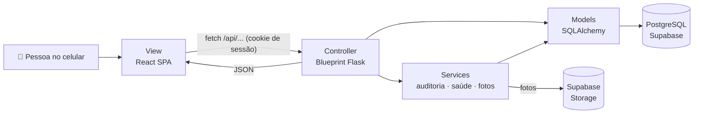
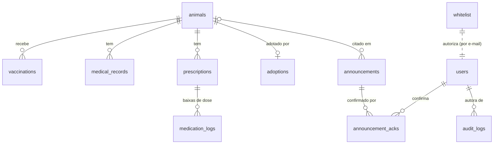
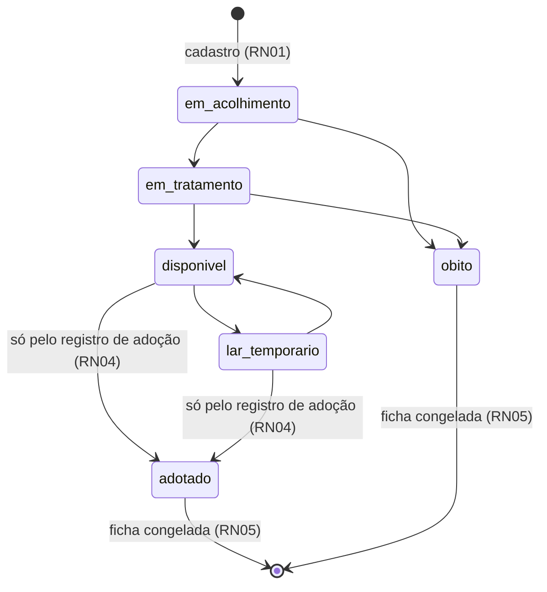

# 🐾 GAPAR Gestão

> O caderno do abrigo, agora no bolso de quem cuida.

O **GAPAR Gestão** é o sistema da ONG GAPAR para acompanhar o dia a dia dos cães acolhidos:
quem chegou, quem precisa de remédio agora, qual vacina vence esta semana e para qual família
cada um foi adotado. Ele substitui as fichas de papel, os grupos de mensagem e a memória de quem
estava no plantão por um lugar só, que funciona bem no celular, com uma mão, no meio da baia.

O sistema foi pensado para duas pessoas:

- **A Administradora**, que coordena o abrigo: cadastra animais, autoriza quem entra no sistema,
  mantém a lista sigilosa de pessoas que não podem adotar e acompanha o histórico de tudo o que
  foi feito.
- **A Voluntária**, que chega para o turno e precisa saber, em segundos, *o que tem para fazer
  hoje*: dar a medicação das 8h, conferir um reforço de vacina, registrar uma consulta.

---

## Sumário

1. [Como o projeto está organizado](#-como-o-projeto-está-organizado)
2. [Rodando na sua máquina](#-rodando-na-sua-máquina)
3. [Front-end: a camada View](#-front-end-a-camada-view)
4. [Back-end: Controllers, Services e Models](#-back-end-controllers-services-e-models)
5. [Banco de dados](#-banco-de-dados)
6. [Testes](#-testes)
7. [Deploy](#-deploy)
8. [Contas de teste](#-contas-de-teste)
9. [Regras de negócio em uma página](#-regras-de-negócio-em-uma-página)

---

## 🧭 Como o projeto está organizado

É um repositório só, com front-end e back-end morando juntos e seguindo o padrão **MVC**:

```
gapar-gestao/
├── app/
│   ├── models/        M  · as entidades do abrigo e as regras que nunca podem ser quebradas
│   ├── views/         V  · a interface em React que as pessoas usam no celular
│   ├── controllers/   C  · as rotas da API: recebem o pedido, aplicam as regras, respondem JSON
│   ├── services/         · o trabalho pesado que os controllers delegam (auditoria, fotos, .ics…)
│   ├── utils/            · ferramentas genéricas (datas no fuso do abrigo, validação, criptografia)
│   ├── static/uploads/   · fotos, só no ambiente de desenvolvimento
│   └── __init__.py       · create_app(): monta a aplicação Flask
├── api/index.py       · porta de entrada da função serverless na Vercel
├── migrations/        · histórico versionado do esquema do banco (Alembic)
├── tests/             · testes automatizados do back-end (pytest)
├── scripts/           · homologação do deploy
└── docs/              · requisitos, planos, telas de referência e guia de deploy
```

Uma requisição percorre o sistema assim:



Em produção, a Vercel serve a interface pela CDN e encaminha `/api/*` e `/auth/*` para o Flask,
tudo no mesmo domínio. Sem CORS e sem dois endereços para configurar.

---

## 💻 Rodando na sua máquina

**Você vai precisar de:** Python 3.12 e Node.js 20 ou mais recente.

```bash
# 1. Back-end
python -m venv .venv
.\.venv\Scripts\Activate.ps1          # Windows (PowerShell)
source .venv/bin/activate             # Linux / macOS
pip install -r requirements-dev.txt   # runtime + ferramentas de teste

# 2. Front-end
npm install

# 3. Configuração
cp .env.example .env                  # e preencha os valores
```

Sem `DATABASE_URL`, o desenvolvimento usa um SQLite local (`gapar_dev.db`). Para criar as
tabelas e, se quiser, popular com animais de demonstração:

```bash
flask --app wsgi db upgrade
flask --app wsgi seed                 # opcional: dados de exemplo
```

Depois, dois terminais:

```bash
npm run dev:api     # Flask em http://127.0.0.1:5000
npm run dev         # Vite em  http://localhost:5173  ← abra este
```

O Vite repassa `/api`, `/auth` e `/static` para o Flask, então você usa só o endereço do Vite.
Em desenvolvimento a tela de login mostra um botão **"Entrar para testar"**, para não depender do
OAuth enquanto programa. Esse botão não existe em produção.

---

## 🎨 Front-end: a camada View

Fica em [`app/views/`](app/views) e é uma **SPA em React 18 + TypeScript**, construída com
**Vite** e estilizada com **Tailwind CSS 4**.

### O que guiou as decisões

- **Celular primeiro.** A navegação fica numa barra inferior, ao alcance do polegar. Em telas
  largas ela vira um menu no topo. Tudo foi conferido a 360 px de largura, sem rolagem lateral.
- **Um toque para o que é urgente.** No painel *Hoje*, baixar uma dose é um botão, e a tela
  atualiza na hora.
- **Linguagem de gente, não de sistema.** A tela fala em "Pessoas autorizadas", "Lista
  sigilosa" e "Histórico de ações", e não em *whitelist*, *blacklist* ou *audit log*. Os erros
  da API chegam como frases que ajudam a pessoa a resolver.
- **Acolhedor e acessível.** A paleta mistura verde-mata, creme e terracota, com a fonte
  Nunito. O foco do teclado é sempre visível, e a interface respeita a opção "reduzir
  movimento" do aparelho.

### As telas

| Rota | Tela | Para quem |
|---|---|---|
| `/entrar` | Login com Google | todos |
| `/hoje` | Painel do dia: doses pendentes, reforços de vacina do dia e atrasados | todos |
| `/animais` | Catálogo com busca, filtros combinados e carregamento progressivo | todos |
| `/animais/novo` | Cadastro de resgate; a foto pode vir da câmera e é reduzida no próprio aparelho | todos |
| `/animais/:id` | Ficha em abas: Dados · Saúde (vacinas) · Prontuário · Medicações · Adoção | todos |
| `/admin` | Pessoas autorizadas, lista sigilosa e histórico de ações | só Administradora |

Animais **adotados** ou que vieram a **óbito** abrem a ficha em modo de consulta: o histórico
fica preservado e ninguém edita por engano.

### Por dentro

```
app/views/src/
├── api/          um arquivo por recurso (animais, saude, adocoes…) + http.ts, o cliente único
├── pages/        uma página por rota; a ficha do animal é dividida em pages/ficha/Aba*.tsx
├── components/   peças reutilizáveis: Botao, Campos, Dialogo, FotoAnimal, Layout, Selos…
├── contexts/     AuthContext (quem está logado) e AvisosContext (mensagens na tela)
├── hooks/        useCarregar: carregamento com estados de espera e de erro
├── utils/        datas, status, horários e mensagens, com testes em utils.test.ts
└── types/        os tipos TypeScript que espelham o JSON da API
```

O [`api/http.ts`](app/views/src/api/http.ts) é a única porta de saída para o servidor. Ele manda
o cookie de sessão, transforma qualquer falha em um `ErroApi` com mensagem pronta e avisa o app
inteiro quando a sessão expira (401) ou quando o acesso foi revogado (403). Assim a pessoa
entende o que aconteceu.

### Comandos

| Comando | O que faz |
|---|---|
| `npm run dev` | servidor de desenvolvimento com recarga instantânea |
| `npm run build` | checa os tipos (`tsc`) e gera o build de produção em `dist/` |
| `npm test` | roda os testes do Vitest |

---

## ⚙️ Back-end: Controllers, Services e Models

**Python 3.12 + Flask 3**, com SQLAlchemy 2, Flask-Login para a sessão e `google-auth` para
validar o login do Google. Tudo que entra e sai é **JSON**, e os erros sempre têm o mesmo
formato:

```json
{ "erro": "Adoção não autorizada", "codigo": 422, "mensagem": "Explicação para a pessoa." }
```

### Controllers: as rotas da API

Cada arquivo em [`app/controllers/`](app/controllers) é um Blueprint responsável por um assunto:

| Controller | Prefixo | Responsabilidade |
|---|---|---|
| `auth_controller` | `/auth` | Login com Google (RF01), checagem da Whitelist (RF02), sessão, logout |
| `core_controller` | `/api/hoje` | Painel operacional do dia (RF23) |
| `animals_controller` | `/api/animais` | Cadastro, busca e filtros, edição, mudança de status, exclusão lógica, foto |
| `health_controller` | `/api/saude` | Vacinas (RF13), prontuário (RF14), prescrições, baixa de dose (RF16), lembretes `.ics` |
| `adoptions_controller` | `/api/adocoes` | Registro formal da adoção (RF20) com checagem na lista sigilosa (RN15) |
| `admin_controller` | `/api/admin` | Whitelist (RF04), lista de não aptos (RF22), auditoria paginada e filtrada (RF24) |
| `avisos_controller` | `/api/avisos` | Mural de avisos da diretoria e do turno, com confirmação de leitura |

**Segurança centralizada:** toda rota `/api/*` exige sessão, sem exceção. A trava fica em
`create_app()`, e não em cada rota, para que nenhum endpoint novo nasça aberto por esquecimento.
Rotas da gestão também levam o decorador `@admin_required`.

### Services: o trabalho que os controllers delegam

| Service | O que faz |
|---|---|
| `audit` | Registra cada ação na trilha de auditoria, na mesma transação da própria alteração |
| `saude` | Doses do dia, reforços em aberto e status das prescrições, com número fixo de consultas |
| `images` | Corrige a orientação, redimensiona e comprime a foto até ficar **< 300 KB** (RNF02) |
| `storage` | Grava a foto no Supabase Storage (produção) ou no disco (desenvolvimento) |
| `ics` | Gera os lembretes de medicação e vacina no padrão de calendário (RFC 5545) |

### Utils

`tempo` (o "hoje" no fuso do abrigo, `America/Sao_Paulo`, mesmo com o servidor em UTC) ·
`validation` (leitura e validação das entradas) · `crypto` (cifra dos tokens do Google) ·
`decorators` (`@admin_required`).

### Detalhes que dão tranquilidade

- **Baixa de dose à prova de clique duplo:** se duas voluntárias baixarem a mesma dose ao mesmo
  tempo, só uma é gravada. A outra recebe `ja_baixado: true`, sem erro.
- **Revogação imediata:** desativar alguém na Whitelist vale já na próxima requisição dessa
  pessoa (RN14).
- **A Administradora não se tranca para fora:** o sistema impede desativar a si mesma,
  desativar a administradora inicial ou ficar sem nenhuma administradora.
- **LGPD:** CPF e endereço do adotante só aparecem para a Administradora. Os tokens do Google
  ficam cifrados no banco.
- **Produção que não sobe pela metade:** sem `SECRET_KEY` forte, banco PostgreSQL ou
  credenciais do Google, a aplicação se recusa a iniciar e diz exatamente o que falta.

### Comandos úteis

```bash
flask --app wsgi routes          # lista todas as rotas
flask --app wsgi db upgrade      # aplica as migrações pendentes
flask --app wsgi create-admin    # autoriza a administradora inicial
flask --app wsgi seed            # dados de demonstração (não use no banco de produção)
```

---

## 🗄️ Banco de dados

**PostgreSQL no Supabase**, acessado pelo *pooler* de transações (porta `6543`), que é o
indicado para funções serverless. As fotos ficam no bucket público `animais` do Supabase
Storage. Em desenvolvimento, sem `DATABASE_URL`, o mesmo esquema roda em SQLite.

### As tabelas e como se relacionam



| Tabela | O que guarda |
|---|---|
| `animals` | O cão: dados físicos, resgate, baia, castração/microchip, foto e **status operacional** |
| `vaccinations` | Cartão de vacina: aplicação, lote e data de reforço |
| `medical_records` | Prontuário: consultas, exames, cirurgias e diagnósticos |
| `prescriptions` | Tratamentos: remédio, dosagem, horários (`"08:00, 20:00"`) e período |
| `medication_logs` | Cada dose dada: prescrição, dia, horário previsto e horário real |
| `adoptions` | A adoção: adotante, contato, documento, termo assinado (uma por animal) |
| `non_eligible_people` | **Lista sigilosa** de pessoas impedidas de adotar (só a Administradora vê) |
| `whitelist` | E-mails autorizados a entrar e o perfil de cada um |
| `users` | Quem já entrou pelo Google: nome, perfil, tokens cifrados |
| `announcements` / `announcement_acks` | Mural de avisos e quem confirmou a leitura |
| `audit_logs` | A trilha de tudo o que foi feito: quem, o quê, em qual registro, quando e de qual IP |

### O ciclo de vida de um animal



Entre os status ativos a troca é livre. `adotado` e `óbito` são finais.

### Proteções que moram no próprio banco

As regras mais importantes não dependem só do código Python. Elas estão no PostgreSQL e valem
mesmo para quem acessar o banco por fora da aplicação:

- **Nada se apaga de verdade (RN03):** *triggers* bloqueiam `DELETE` e `TRUNCATE` em
  `animals`, `vaccinations` e `medical_records`. Remover um animal é uma exclusão lógica
  (`is_deleted`).
- **A auditoria é imutável (RN16):** `audit_logs` não aceita `UPDATE`, `DELETE` nem `TRUNCATE`.
- **Domínios fechados:** `CHECK` para status, sexo, porte, perfis, peso positivo, fim da
  prescrição depois do início e reforço depois da aplicação.
- **Sem duplicidade:** uma adoção por animal, uma baixa por dose e horário, uma confirmação por
  aviso e pessoa, e e-mails únicos.
- **Índices** nas buscas do catálogo, do painel *Hoje* e dos filtros da auditoria.

### Migrações

O esquema é versionado com Alembic, em [`migrations/versions/`](migrations/versions):

| Revisão | Conteúdo |
|---|---|
| `0001` | Esquema inicial completo, com a Whitelist |
| `0002` | Integridade: `CHECK`, `UNIQUE`, *triggers* RN03/RN16 e índices |

Para mudar o esquema, altere o model, gere a migração e revise o arquivo antes de aplicar:

```bash
flask --app wsgi db migrate -m "descreva a mudança"
flask --app wsgi db upgrade
```

---

## 🧪 Testes

```bash
python -m pytest        # back-end: regras de negócio, segurança, banco, produção
npm test                # front-end: utilitários de datas, status, horários e mensagens
```

A suíte do back-end roda num SQLite em memória e cobre os pontos sensíveis: o caminho completo
do login e da revogação, a máquina de status, o congelamento da ficha, o bloqueio pela lista
sigilosa, as baixas simultâneas, a imutabilidade da auditoria, as restrições do banco, a
compressão das fotos, o formato do `.ics` e a configuração de produção.

---

## 🚀 Deploy

Um único projeto na **Vercel** (`gapar-gestao`, time *Gapar*), ligado a este repositório:

- push na `main` publica em **produção**;
- cada pull request ganha um **preview** próprio.

As variáveis de ambiente, a configuração do Google OAuth e o roteiro de homologação estão em
[`docs/DEPLOY.md`](docs/DEPLOY.md). Depois de publicar, confira tudo com:

```bash
python scripts/homologacao.py https://<domínio-de-produção>
```

---

## 👥 Contas de teste

O login é **só pelo Google**: não existe senha no sistema. Para testar, entre com uma destas
contas, já autorizadas na Whitelist:

| Perfil | Conta Google |
|---|---|
| Administradora | `yuricarlosfilho@gmail.com` |
| Voluntária | `yuri.alves07@aluno.ifce.edu.br` |

Novas pessoas são autorizadas pela própria Administradora, na tela de gestão.

---

## 📜 Regras de negócio em uma página

| Código | Regra |
|---|---|
| RN01 | Todo animal novo entra como `em acolhimento`, com a data do dia |
| RN02 | Mudanças de status seguem a máquina de estados acima |
| RN03 | Animais, prontuários e vacinas nunca são apagados fisicamente |
| RN04 | Adoção exige nome, telefone e data do adotante |
| RN05 | Animais adotados ou em óbito têm a ficha congelada |
| RN12 | Só entra quem está ativo na Whitelist |
| RN13 | A administradora inicial sempre consegue entrar |
| RN14 | Desativar alguém vale na próxima requisição dessa pessoa |
| RN15 | A lista sigilosa bloqueia adoções e só a Administradora a vê |
| RN16 | A trilha de auditoria é imutável |

A especificação completa (ISO/IEC/IEEE 29148) está em
[`docs/Requisitos_GAPAR.pdf`](docs/Requisitos_GAPAR.pdf).

---

<sub>Feito com carinho para quem cuida de quem não tem voz. 🐕</sub>
