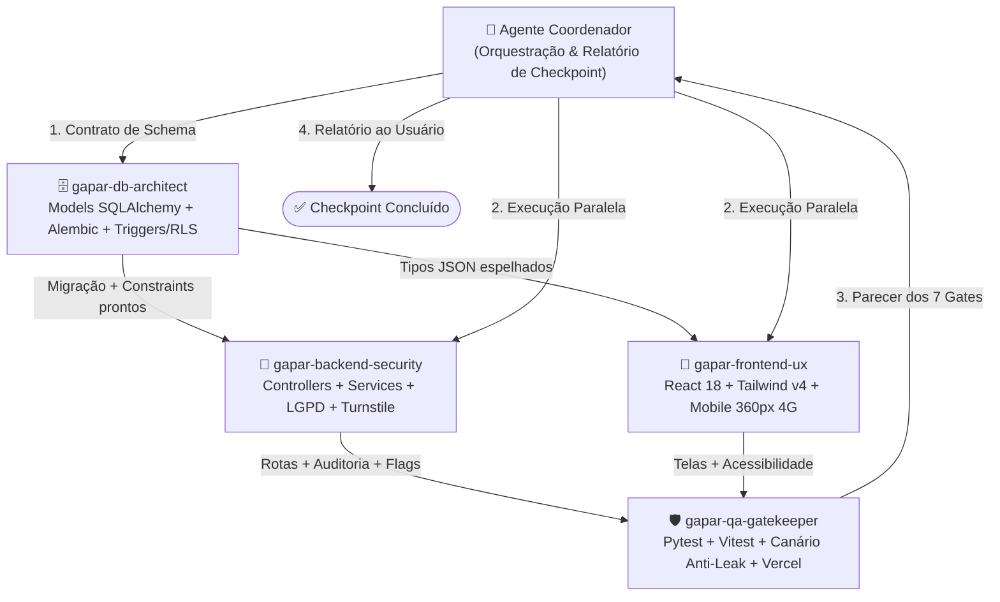
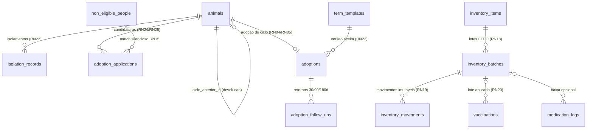
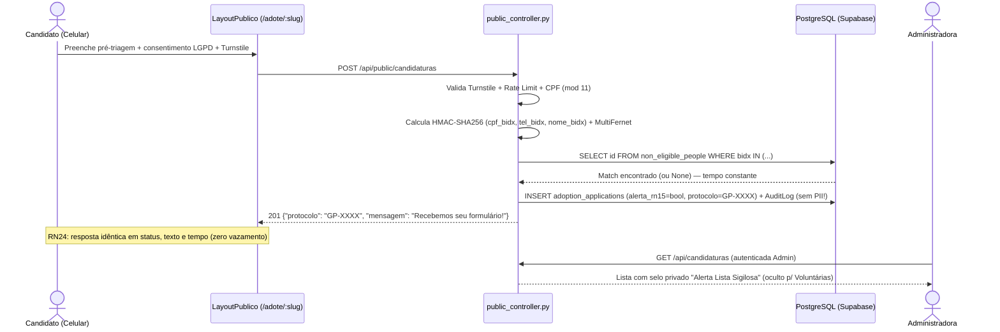

# 📐 SDD v5.0 — Especificação de Projeto (Spec-Driven Design) & Orquestração Multiagente
## Ampliação do GAPAR Gestão: Fases 0, 2, 3 e 4 (Itens 1 a 9)

> **Sistema:** GAPAR Gestão — Plataforma de Controle de Abrigo, Saúde Animal e Adoção Responsável  
> **Padrão Normativo:** ISO/IEC/IEEE 29148:2018 & IEEE 1016 (Software Design Description — v5.0 Planejada)  
> **Base de Código Inspecionada:** Arquitetura MVC Unificada (`app/models`, `app/views`, `app/controllers`, `app/services`, `app/utils`, migrações `0001` e `0002`, Vercel Serverless + Supabase PostgreSQL/Storage)  
> **Horizonte:** 17 Sprints de 2 semanas (14/12/2026 a 15/08/2027) organizadas em **11 Checkpoints Auditáveis**  

---

## 1. Diagnóstico Técnico da Proposta de Ampliação frente ao Código Atual

A revisão cruzada entre o documento *"GAPAR Gestão — Planejamento das Fases 2 e 3"* e o código-fonte atual revelou uma base MVC muito sólida, mas identificou **8 pontos críticos de acoplamento** que este SDD resolve antes da primeira linha de código:

| # | Achado no Código Atual | Impacto na Ampliação | Solução Projetada neste SDD |
| :-: | :--- | :--- | :--- |
| **A1** | `require_authenticated_api()` em `app/__init__.py` bloqueia **qualquer** `request.path.startswith("/api/")` sem sessão (`401`), e sessões revogadas retornam `403`. | Impediria `/api/public/*` de responder a visitantes anônimos e quebraria a vitrine (`403`) para ex-voluntárias com cookie antigo. | Allowlist dupla em `_is_public_api_request()` validando `request.blueprint in {"public", "og"}` + prefixo estrito sem `..`/`//`, limpando silenciosamente cookies revogados em rotas públicas e mantendo *fail-closed* em `/api/*` interno. |
| **A2** | `vercel.json` envia toda rota não-API para `/index.html` estático (SPA), e `api/index.py` exclui `dist/**`. | Crawlers de WhatsApp/Instagram não executam JS: links `/adote/<slug>` ficariam sem prévia de foto (`og:image`). Desviar humanos ao Flask causaria *cold start*. | **Conditional Rewrite por `User-Agent`** no `vercel.json`: bots sociais em `/adote*` caem em `og_controller.py` (HTML escapado + Edge Cache 300s); humanos continuam recebendo `dist/index.html` direto da CDN em `< 10 ms`. |
| **A3** | Na Fase 0 original, o layout público listava apenas `/adote` e `/carteira/:token`. | O **Item 6 (Termo Digital)** exige leitura e aceite pelo adotante sem login, e a **LGPD** exige página pública permanente de privacidade. | Inclusão formal de `/termo/:token`, `/adote/:slug` e `/privacidade` no `LayoutPublico` e no `public_controller.py` desde o desenho da Fase 0. |
| **A4** | `app/utils/crypto.py` deriva chave Fernet direto de `SECRET_KEY` (que é rotacionável para invalidar sessões) e produz cifra não-determinística. | Rotacionar `SECRET_KEY` corromperia CPFs cifrados; e cifrar CPF só com Fernet inviabilizaria busca indexada na Lista Sigilosa (`RN15`/`RN24`). | Separação criptográfica com **`MultiFernet`** (`PII_FERNET_KEYS` dedicada) + **Blind Index determinístico** (`HMAC-SHA256` com `PII_HMAC_KEY` e separação de domínio `cpf:v1:`, `tel:v1:`, `nome:v1:`). |
| **A5** | Em `app/commands.py` (`seed_data`), 4 animais têm `is_microchipado=True` **sem** número de 15 dígitos; além disso, **RN21** exige microchip único e o **Item 5** abre novo ciclo de acolhimento na devolução. | Uma constraint `UNIQUE(numero_microchip)` global bloquearia reacolher um cão devolvido que já tem microchip na ficha congelada (`RN05`), e derivar `is_microchipado` sem transição apagaria dados legados. | Manter flag booleana sincronizada (legado preservado; novos exigem 15 dígitos ISO) + **Índice Único Parcial** em ciclos ativos (`WHERE status_operacional NOT IN ('adotado','óbito') AND is_deleted = FALSE`), permitindo continuidade física rastreada via `ciclo_anterior_id`. |
| **A6** | `audit_logs` possui trigger PostgreSQL `trg_audit_logs_imutavel` (`0002`) que proíbe `UPDATE` e `DELETE` (**RN16**). | Gravar CPF/telefone/nome de candidatos em `AuditLog.detalhes` tornaria impossível cumprir a anonimização pós-retenção (**RN25**) sem violar **RN16**. | Proibição estrita de PII de candidatos públicos em `AuditLog.detalhes` (registrar apenas `protocolo` público `GP-XXXXXXXX` e `entidade_id`), conciliando 100% **RN16** com **RN25** (LGPD Art. 16). |
| **A7** | Migração `0002` habilita `ROW LEVEL SECURITY` (sem policies) para fechar a Data API pública (PostgREST) do Supabase. | Qualquer tabela nova das Fases 0–4 criada sem `ENABLE ROW LEVEL SECURITY` ficaria exposta na API REST automática do Supabase. | Gate obrigatório de migração e teste (`tests/test_db_constraints.py`): 100% das novas tabelas entram em `TABELAS_RLS`. |
| **A8** | Cota do Supabase Free (CPU Nano + 5 GB Egress) e limite de 250 MB descomprimidos da função Python na Vercel. | Post viral de adoção pode gerar dezenas de milhares de acessos em minutos; libs pesadas (`weasyprint`, `pandas`, `google-api-python-client`) estouram 250 MB. | Zero `Set-Cookie` + `Vercel-CDN-Cache-Control: public, s-maxage=300, stale-while-revalidate=3600` nas leituras públicas + `reportlab` puro Python (bundle total projetado: **~95 MB / 250 MB**). |

---

## 2. Arquitetura de Orquestração com Multiagentes Especialistas

Cada Checkpoint deste SDD é executado por uma **Squad de 4 Agentes Especialistas** coordenados pelo Agente Orquestrador Principal, com separação clara entre quem implementa e quem audita:

### Perfis Registrados e Escopo de Atuação
1. **`gapar-db-architect` (Dados & PostgreSQL/Supabase):** Dona de `app/models/` e `migrations/versions/`. Garante migrações reversíveis (`upgrade`/`downgrade`), `batch_alter_table` (compatibilidade SQLite + PostgreSQL), triggers PL/pgSQL (`RN03`, `RN16`, `RN19`), índices parciais e `ENABLE ROW LEVEL SECURITY`.
2. **`gapar-backend-security` (API Flask, Segurança & LGPD):** Dona de `app/controllers/`, `app/services/`, `app/utils/` e `app/__init__.py`. Implementa allowlist pública, `MultiFernet` + Blind Index `HMAC-SHA256`, validação Cloudflare Turnstile, rate limit atômico, geração de PDF com `reportlab` e gravação transacional em `AuditLog`.
3. **`gapar-frontend-ux` (React Mobile-First & UX Humana):** Dona de `app/views/src/`. Garante separação `LayoutPublico` / `LayoutInterno`, consumo de `FlagsContext`, ergonomia de uma mão a `360px`, contraste WCAG AA ($\ge 4.5:1$), zero jargão técnico e *code-splitting* rigoroso (`vendor-mapa`, `vendor-qrcode`).
4. **`gapar-qa-gatekeeper` (Qualidade, Regras RN01–RN25 & DevOps Vercel):** Dona de `tests/`, `app/views/src/**/*.test.ts`, `scripts/homologacao.py`, `vercel.json`, `README.md` e `docs/DEPLOY.md`. Executa os **7 Gates Obrigatórios** e tem poder de veto antes do fechamento de cada Checkpoint.

---

## 3. Planejamento Executivo em 11 Checkpoints (17 Sprints)

```mermaid
flowchart LR
    CP01["CP-01 · Fase 0<br/>Fundamentos & LGPD<br/>(Sprint 1)"] --> CP02["CP-02 · Item 1<br/>Vitrine + OG<br/>(Sprints 2-3)"]
    CP02 --> CP03["CP-03 · Item 2<br/>Estoque FEFO<br/>(Sprints 4-5)"]
    CP03 --> CP04["CP-04 · Item 3<br/>Microchip & QR<br/>(Sprint 6)"]
    CP04 --> CP05["CP-05 · Item 4<br/>Kanban, Isolamento<br/>& Homolog. Fase 2<br/>(Sprints 7-8)"]
    CP05 --> CP06["CP-06 · Item 5<br/>Pós-Adoção &<br/>Devolução (Sprint 9)"]
    CP06 --> CP07["CP-07 · Item 6<br/>Termo Digital PDF<br/>(Sprints 10-11)"]
    CP07 --> CP08["CP-08 · Item 7<br/>Pré-Triagem Online<br/>(Sprints 12-13)"]
    CP08 --> CP09["CP-09 · Item 8<br/>Carteira Vacinas &<br/>Homolog. Fase 3<br/>(Sprints 14-15)"]
    CP09 --> CP10["CP-10 · Item 9<br/>Mapa Resgates<br/>(Sprint 16)"]
    CP10 --> CP11["CP-11 · Go-Live<br/>Homologação v5.0<br/>(Sprint 17)"]
```

### Tabela Mestra de Checkpoints, Sprints, Branches e Entregas

| Checkpoint | Período / Sprints | Branch & Migração Alembic | Entregas Principais (Back + Front + Banco) | Critério de Pronto (Validação Obrigatória) |
| :--- | :--- | :--- | :--- | :--- |
| **CP-01** | **Sprint 1** 14/12 a 27/12/2026 *(Fase 0)* | `feat/cp01-fase0-fundamentos` `0003_fase0_seguranca_lgpd` | • `public_bp` (`/api/public/*`) + ajuste fail-closed em `app/__init__.py` • `Animal.to_public_dict()` com allowlist estrita • `MultiFernet` + Blind Index `HMAC-SHA256` em `crypto.py` + backfill em `non_eligible_people` e `adoptions` • `turnstile_service.py` + `rate_limit_buckets` + headers `vercel.json` • Feature Flags (`@require_feature` + `FlagsContext.tsx`) • `LayoutPublico.tsx` + `/privacidade` + fix isolamento `conftest.py` | Teste canário `test_canary_anti_leak.py` 100% verde; `GET /api/public/*` sem `Set-Cookie`; `NonEligiblePerson` consultada por blind index; regras de Firewall documentadas/ativas na Vercel. |
| **CP-02** | **Sprints 2–3** 04/01 a 31/01/2027 *(Fase 2 · Item 1)* | `feat/cp02-vitrine-publica` `0004_vitrine_publica` | • `is_publicado`, `slug_publico` (UUID), `descricao_publica`, `pausar_candidaturas` em `animals` • `GET /api/public/animais` e `GET /api/public/animais/<slug>` com Edge Cache • `og_controller.py` + Conditional Rewrite WhatsApp no `vercel.json` • Telas `/adote`, `/adote/:slug` (CTA WhatsApp) e controle na `AbaDados` (Admin) | **RN17** validada em `pytest` (sair de `disponível` tira da vitrine na hora); preview Open Graph com foto `< 300 KB` validado; zero dado interno exposto. |
| **CP-03** | **Sprints 4–5** 01/02 a 28/02/2027 *(Fase 2 · Item 2)* | `feat/cp03-estoque-insumos` `0005_estoque_insumos` | • Tabelas `inventory_items`, `inventory_batches`, `inventory_movements` (imutável) • `inventory_service.py` com bloqueio transacional (`FOR UPDATE`) e ordenação FEFO • Baixa automática ao registrar `Vaccination` (obrigatória se usar lote) e opcional em `Prescription`/`MedicationLog` • Tela `/estoque` + `<SeletorLoteFefo />` + alertas no `HojePage` | **RN18** (saldo nunca negativo, inclusive em corrida concorrente), **RN19** (movimento imutável via ORM e trigger PG) e **RN20** (lote vencido rejeitado `422`) 100% cobertos em `pytest`. |
| **CP-04** | **Sprint 6** 01/03 a 14/03/2027 *(Fase 2 · Item 3)* | `feat/cp04-microchip-qrcode` `0006_microchip_iso` | • `numero_microchip` (`CHAR(15)` numérico ISO 11784/11785) em `animals` preservando legado • Busca instantânea sem debounce para leitores USB HID (15 dígitos + `Enter`) em `AnimaisPage` • `<DialogoEtiquetaBaia />` A6 retrato (`@media print` + `qrcode` SVG em chunk `lazy`) | **RN21** validada no banco e serviço; Vitest cobrindo formatação/validação 15 dígitos; bundle principal sem aumento (`vendor-qrcode` isolado). |
| **CP-05** | **Sprints 7–8** 15/03 a 11/04/2027 *(Fase 2 · Item 4 + Homologação)* | `feat/cp05-kanban-isolamento` `0007_isolamento_sanitario` | • Tabela `isolation_records` + índice único parcial de isolamento aberto • Alternância Lista ↔ Quadro Kanban em `/animais` (DnD desktop; folha `"Mover..."` a 360px) • `<SeloIsolamento />`, banner na ficha e bloco prioritário no topo do `HojePage` + ocultação automática na vitrine • `scripts/homologacao.py` Fase 2 + homologação mobile real | **RN22** (máx. 1 isolamento aberto por animal) validada em PostgreSQL e SQLite; `homologacao.py` retorna `0`; ativação gradual das flags `FEATURE_VITRINE..ISOLAMENTO`. |
| **CP-06** | **Sprint 9** 12/04 a 25/04/2027 *(Fase 3 · Item 5)* | `feat/cp06-pos-adocao` `0008_pos_adocao_devolucao` | • Tabela `adoption_follow_ups` + configuração de prazos (padrão 30, 90, 180 dias) • Geração automática dos 3 retornos no registro da adoção + alertas no `HojePage` com `wa.me` • Fluxo seguro de **Devolução** abrindo novo ciclo (`ciclo_anterior_id`, `animal_raiz_id`) sem editar ficha congelada | Preservação integral de **RN05** e **RN06** na devolução; animal devolvido mantém rastreabilidade de vacinas/microchip da raiz e auditoria completa. |
| **CP-07** | **Sprints 10–11** 26/04 a 23/05/2027 *(Fase 3 · Item 6)* | `feat/cp07-termo-digital` `0009_termo_digital` | • Tabela `term_templates` (append-only versionada) + colunas de assinatura eletrônica simples em `adoptions` • Link único válido por 48h (`SHA-256` no banco) + página pública `/termo/:token` com confirmação Nome/CPF e Turnstile • `pdf_termo_service.py` (`reportlab` puro) gravando no bucket privado `termos` | **RN23** validada (texto renderizado, versão e hash SHA-256 congelados após aceite; tentativa de reuso/alteração bloqueada); PDF gerado em `< 2s` e bundle Vercel `< 100 MB`. |
| **CP-08** | **Sprints 12–13** 24/05 a 20/06/2027 *(Fase 3 · Item 7)* | `feat/cp08-pre-triagem` `0010_candidaturas_online` | • Tabela `adoption_applications` com PII cifrado + blind index + consentimento LGPD • `<FormularioPreTriagem />` em 3 passos curtos em `/adote/:slug` + botão pausar por animal • Fila `/candidaturas` com alerta `RN15` exclusivo Admin + conversão em 1 clique para Adoção/Termo • Comando/Cron `flask lgpd-anonymize` | **RN24** (pipeline *constant-work* sem revelar bloqueio ao candidato) e **RN25** (anonimização pós-retenção sem tocar em `audit_logs`) provadas em `pytest`. |
| **CP-09** | **Sprints 14–15** 21/06 a 18/07/2027 *(Fase 3 · Item 8 + Homologação)* | `feat/cp09-carteira-vacinas` `0011_carteira_vacinas` | • `token_carteira_hash` (32 bytes aleatórios) e `carteira_revogada_em` em `adoptions` • Página `/carteira/:token` estilo caderneta limpa + download `.ics` de reforços + revogação Admin • Homologação completa da Fase 3 (candidatura → termo → carteira → 1º retorno) | Zero PII do adotante exposto em `/carteira/:token`; link revogado retorna `404`/`410` imediatamente; `.ics` válido conforme RFC 5545; ativação das flags da Fase 3. |
| **CP-10** | **Sprint 16** 19/07 a 01/08/2027 *(Fase 4 · Item 9)* | `feat/cp10-mapa-resgates` `0012_mapa_resgates` | • `resgate_lat`, `resgate_lng`, `resgate_bairro` em `animals` + tabela `geocoding_cache` • `<CapturaLocalizacao />` GPS no cadastro + CLI de backfill Nominatim (1 req/s + fila ambíguos Admin) • Página `/mapa` (`lazy`, exclusiva Admin) com `leaflet` + `supercluster` + exportação agregada só por bairro | Coordenadas exatas restritas à Admin autenticada; relatórios/saídas agregam apenas por bairro; chunk `vendor-mapa` (`~52 KB`) nunca baixado por voluntárias. |
| **CP-11** | **Sprint 17** 02/08 a 15/08/2027 *(Encerramento)* | `feat/cp11-homologacao-v5` *(Sem migração nova)* | • `scripts/homologacao.py` v5.0 cobrindo todas as 4 fases • Revisão final de segurança, índices, cota Vercel/Supabase e textos LGPD • Atualização de `README.md`, `docs/DEPLOY.md` e Especificação de Requisitos v5.0 | 100% da suíte `pytest` + `Vitest` + `homologacao.py` aprovados em produção; todas as 9 funcionalidades homologadas e documentadas. |

### Protocolo Obrigatório de Comunicação de Checkpoint
Ao concluir **qualquer** um dos 11 Checkpoints acima, o Agente Coordenador apresentará obrigatoriamente um boletim estruturado contendo:
1. **Resumo Executivo do que foi entregue** (funcionalidades de negócio em linguagem clara).
2. **Artefatos Técnicos Criados/Alterados** (migração Alembic, models, controllers/services, páginas/componentes React).
3. **Regras de Negócio & Segurança Auditadas** (`RN` cobertas + resultado do Teste Canário Anti-Vazamento e RLS).
4. **Evidências dos Gates** (contagem de testes `pytest`, `Vitest`, status do `npm run build`, tamanho do bundle e PR/branch).
5. **Próximo Checkpoint e eventuais decisões da ONG necessárias antes de avançar**.

---

## 4. Especificação da Camada de Dados (Models & Migrações `0003`–`0012`)

### 4.1. Diagrama Entidade-Relacionamento das Novas Entidades

### 4.2. Detalhamento Técnico das Tabelas e Colunas Novas

1. **`0003_fase0_seguranca_lgpd`**:
   - Nova tabela `rate_limit_buckets`: `bucket_key VARCHAR(120) PK`, `window_start TIMESTAMP NOT NULL`, `hit_count INTEGER NOT NULL`.
   - Em `non_eligible_people`: adiciona `cpf_cifrado TEXT`, `cpf_bidx CHAR(64)` (indexado), `telefone_cifrado TEXT`, `telefone_bidx CHAR(64)` (indexado), `nome_bidx CHAR(64)` (indexado). **(Revisado v5.1, ver §10-R1)** A migração `0003a` só adiciona colunas; o backfill é feito pelo comando `flask pii-backfill`, e a remoção de `cpf`/`telefone` em claro fica na migração `0003b`, aplicada só após conferência em produção.
   - Em `adoptions`: adiciona `adotante_cpf_cifrado TEXT`, `adotante_cpf_bidx CHAR(64)` (indexado), `adotante_endereco_cifrado TEXT` (mantendo `Adoption.to_dict(completo=...)` transparente via properties).

2. **`0004_vitrine_publica`** (`animals`):
   - `is_publicado BOOLEAN NOT NULL DEFAULT FALSE`
   - `slug_publico VARCHAR(40) UNIQUE` (UUIDv4 curto/canônico gerado na 1ª publicação, nunca expõe `id` sequencial na URL)
   - `descricao_publica TEXT NULL`
   - `pausar_candidaturas BOOLEAN NOT NULL DEFAULT FALSE` (mitigação de sobrecarga de fila da ONG)
   - Índice composto `ix_animals_vitrine_publica (is_deleted, is_publicado, status_operacional, created_at)`
   - **Regra automática RN17 (Service + Event Hook):** qualquer transição em que `status_operacional != 'disponível'` ou `is_deleted == True` força `is_publicado = False` na mesma transação.

3. **`0005_estoque_insumos`**:
   - `inventory_items`: `id PK`, `nome VARCHAR(120) NOT NULL`, `categoria VARCHAR(30) NOT NULL` (`CHECK IN ('Vacina','Medicamento','Vermífugo','Antipulgas','Ração','Insumo Clínico','Limpeza')`), `unidade VARCHAR(20) NOT NULL` (`doses`, `comprimidos`, `ml`, `kg`, `unidades`), `estoque_minimo NUMERIC(10,2) NOT NULL DEFAULT 0 CHECK (estoque_minimo >= 0)`, `is_active BOOLEAN NOT NULL DEFAULT TRUE`, `is_deleted BOOLEAN NOT NULL DEFAULT FALSE`, `created_at`, `updated_at`.
   - `inventory_batches`: `id PK`, `item_id FK(inventory_items.id) NOT NULL`, `codigo_lote VARCHAR(60) NOT NULL`, `data_validade DATE NULL`, `saldo_atual NUMERIC(10,2) NOT NULL CHECK (saldo_atual >= 0)` (**RN18**), `created_at`. `UNIQUE(item_id, codigo_lote)`. Índice FEFO `ix_batches_fefo (item_id, data_validade ASC, id ASC)`.
   - `inventory_movements` (`@tornar_imutavel` — **RN19**): `id PK`, `batch_id FK(inventory_batches.id) NOT NULL`, `tipo VARCHAR(20) NOT NULL` (`CHECK IN ('ENTRADA','SAIDA_USO','AJUSTE_MAIS','AJUSTE_MENOS','DESCARTE_VALIDADE','PERDA')`), `quantidade NUMERIC(10,2) NOT NULL CHECK (quantidade > 0)`, `saldo_apos NUMERIC(10,2) NOT NULL CHECK (saldo_apos >= 0)`, `motivo VARCHAR(255) NOT NULL`, `animal_id FK(animals.id) NULL`, `vaccination_id FK(vaccinations.id) NULL`, `medication_log_id FK(medication_logs.id) NULL`, `user_id FK(users.id, ondelete='SET NULL') NULL`, `created_at TIMESTAMP NOT NULL`.
   - Em `prescriptions`: `inventory_item_id FK(inventory_items.id) NULL`, `descontar_estoque BOOLEAN NOT NULL DEFAULT FALSE`, `quantidade_por_dose NUMERIC(10,2) NULL`.

4. **`0006_microchip_iso`** (`animals`):
   - `numero_microchip VARCHAR(15) NULL` com `CHECK (numero_microchip IS NULL OR length(numero_microchip) = 15)` (+ validação regex `^\d{15}$` no Python e `~ '^[0-9]{15}$'` no PostgreSQL).
   - Índice de busca `ix_animals_numero_microchip` + **Índice Único Parcial** `uq_animals_microchip_ciclo_ativo ON animals (numero_microchip) WHERE numero_microchip IS NOT NULL AND is_deleted = FALSE AND status_operacional NOT IN ('adotado', 'óbito')` (suportado nativamente tanto no PostgreSQL quanto no SQLite 3.8+!). No serviço de cadastro comum, se o microchip já pertencer a um animal `'adotado'`, retorna `409` orientando usar o fluxo formal de **Devolução/Reacolhimento** (**RN21**).
   - Compatibilidade legada: sempre que `numero_microchip` é preenchido, `is_microchipado` passa a `True`; animais antigos do banco com `is_microchipado=True` e `numero_microchip IS NULL` continuam válidos até que o número seja lido.

5. **`0007_isolamento_sanitario`**:
   - `isolation_records` (`@proibir_exclusao_fisica`): `id PK`, `animal_id FK(animals.id) NOT NULL`, `motivo VARCHAR(200) NOT NULL`, `protocolo_cuidados TEXT NULL`, `data_inicio DATE NOT NULL`, `data_fim_prevista DATE NULL CHECK (data_fim_prevista IS NULL OR data_fim_prevista >= data_inicio)`, `fim_real TIMESTAMP NULL`, `aberto_por_user_id FK(users.id, ondelete='SET NULL')`, `encerrado_por_user_id FK(users.id, ondelete='SET NULL')`, `observacoes_alta TEXT NULL`, `created_at`.
   - **RN22 no banco:** Índice único parcial `uq_isolation_aberto_por_animal ON isolation_records (animal_id) WHERE fim_real IS NULL` (funciona em PostgreSQL e SQLite!).

6. **`0008_pos_adocao_devolucao`**:
   - `adoption_follow_ups` (`@proibir_exclusao_fisica`): `id PK`, `adoption_id FK(adoptions.id) NOT NULL`, `marco_dias INTEGER NOT NULL CHECK (marco_dias > 0)`, `data_prevista DATE NOT NULL`, `data_realizada DATE NULL`, `canal VARCHAR(30) NULL` (`WhatsApp`, `Telefone`, `Visita`, `Outro`), `resultado VARCHAR(20) NULL` (`CHECK (resultado IS NULL OR resultado IN ('ok','atencao','devolucao'))`), `observacoes TEXT NULL`, `is_cancelado BOOLEAN NOT NULL DEFAULT FALSE`, `realizado_por_user_id FK(users.id, ondelete='SET NULL') NULL`, `created_at`.
   - Em `animals`: `ciclo_anterior_id FK(animals.id) NULL UNIQUE`, `animal_raiz_id FK(animals.id) NULL INDEX` (permite consultar todo o histórico clínico/vacinal de ciclos anteriores em `O(1)` sem violar o congelamento `RN05` da ficha adotada anterior!).
   - Em `adoptions`: `encerrada_por_devolucao_em TIMESTAMP NULL`, `novo_ciclo_animal_id FK(animals.id) NULL` *(únicos campos de fechamento de ciclo, gravados exclusivamente na transação de devolução da Administradora)*.

7. **`0009_termo_digital`**:
   - `term_templates` (`@tornar_imutavel`): `id PK`, `versao VARCHAR(20) UNIQUE NOT NULL` (ex.: `"v1.0-2027"`), `titulo VARCHAR(150) NOT NULL`, `corpo_template TEXT NOT NULL`, `conteudo_sha256 CHAR(64) NOT NULL`, `criado_por_user_id FK(users.id, ondelete='SET NULL')`, `created_at`. *(Modelo vigente = `ORDER BY id DESC LIMIT 1`, 100% append-only)*.
   - Em `adoptions`: `termo_template_id FK(term_templates.id) NULL`, `termo_versao VARCHAR(20) NULL`, `termo_texto_congelado TEXT NULL`, `termo_hash CHAR(64) NULL` (**RN23**), `termo_token_hash CHAR(64) NULL UNIQUE`, `termo_expira_em TIMESTAMP NULL`, `tentativas_cpf_falhas INTEGER NOT NULL DEFAULT 0`, `aceite_em TIMESTAMP NULL`, `aceite_ip_hash CHAR(64) NULL`, `aceite_user_agent VARCHAR(255) NULL`, `aceite_canal VARCHAR(20) NULL` (`digital_link` | `papel_fisico`), `termo_storage_path VARCHAR(255) NULL`.
   - Trigger PostgreSQL + guard ORM impedindo alterar `termo_versao`, `termo_texto_congelado`, `termo_hash` e `aceite_em` uma vez preenchidos (**RN23**).

8. **`0010_candidaturas_online`**:
   - `adoption_applications` (`@proibir_exclusao_fisica` — anonimizável via `UPDATE`, nunca `DELETE` físico): `id PK`, `protocolo VARCHAR(20) UNIQUE NOT NULL`, `animal_id FK(animals.id) NOT NULL INDEX`, `candidato_nome VARCHAR(150) NOT NULL`, `nome_bidx CHAR(64) NULL INDEX`, `cpf_cifrado TEXT NULL`, `cpf_bidx CHAR(64) NULL INDEX`, `telefone_cifrado TEXT NULL`, `telefone_bidx CHAR(64) NULL INDEX`, `cidade_uf VARCHAR(100) NULL`, `respostas_json JSON NOT NULL`, `status VARCHAR(20) NOT NULL DEFAULT 'nova'` (`CHECK IN ('nova','em_analise','entrevista','aprovada','recusada','desistiu','anonimizada')`), `alerta_rn15 BOOLEAN NOT NULL DEFAULT FALSE`, `non_eligible_match_id FK(non_eligible_people.id, ondelete='SET NULL') NULL`, `consentimento_lgpd_em TIMESTAMP NOT NULL`, `consentimento_versao VARCHAR(20) NOT NULL`, `ip_hash CHAR(64) NULL`, `analisado_por_user_id FK(users.id, ondelete='SET NULL') NULL`, `adoption_id FK(adoptions.id) NULL UNIQUE`, `retencao_ate TIMESTAMP NULL INDEX`, `anonimizado_em TIMESTAMP NULL`, `created_at`, `updated_at`.
   - Índice único parcial `uq_candidatura_ativa_animal_cpf ON adoption_applications (animal_id, cpf_bidx) WHERE cpf_bidx IS NOT NULL AND status IN ('nova','em_analise','entrevista')`.

9. **`0011_carteira_vacinas`** (`adoptions`):
   - `token_carteira_hash CHAR(64) NULL UNIQUE` (gerado de `secrets.token_urlsafe(32)`) + `token_carteira_cifrado TEXT NULL` (para a ONG reenviar o link ao tutor sem precisar regerar) + `carteira_revogada_em TIMESTAMP NULL`.

10. **`0012_mapa_resgates`**:
    - Em `animals`: `resgate_lat NUMERIC(8,5) NULL`, `resgate_lng NUMERIC(8,5) NULL`, `resgate_bairro VARCHAR(120) NULL INDEX`, `resgate_geocodificado_status VARCHAR(20) NULL` (`CHECK IN ('gps_direto','mapa_manual','nominatim_ok','ambiguo_revisar','nao_encontrado')`).
    - `geocoding_cache`: `query_hash CHAR(64) PK`, `query_normalizada VARCHAR(255) NOT NULL`, `lat NUMERIC(8,5) NULL`, `lng NUMERIC(8,5) NULL`, `bairro VARCHAR(120) NULL`, `ambigua BOOLEAN NOT NULL DEFAULT FALSE`, `created_at`.

### 4.3. Governança de Triggers PostgreSQL, RLS no Supabase e Paridade SQLite
- **Trigger `gapar_bloquear_exclusao_fisica()` (`RN03`):** expandido para `isolation_records`, `adoption_follow_ups`, `adoption_applications`, `inventory_items` e `inventory_batches`.
- **Triggers de Imutabilidade (`RN16`, `RN19`, `RN23`):**
  - Nova função `gapar_bloquear_mutacao_registro_imutavel()` aplicada a `inventory_movements` (`'RN19'`) e `term_templates` (`'RN23'`) bloqueando `UPDATE`, `DELETE` e `TRUNCATE` com `ERRCODE = 'restrict_violation'`.
  - Nova função `gapar_proteger_evidencia_termo()` (`BEFORE UPDATE ON adoptions`) impedindo alterar `termo_versao`, `termo_texto_congelado`, `termo_hash`, `aceite_em` e `aceite_canal` após `OLD.aceite_em IS NOT NULL`, enquanto permite atualizar pós-adoção e carteira digital.
- **Row Level Security (`ENABLE ROW LEVEL SECURITY` sem policies):** aplicado em **100% das novas tabelas** (`rate_limit_buckets`, `inventory_items`, `inventory_batches`, `inventory_movements`, `isolation_records`, `adoption_follow_ups`, `term_templates`, `adoption_applications`, `geocoding_cache`), e nunca desligado em `downgrade()`.
- **4 Garantias de Paridade Estrita PostgreSQL 15+ ↔ SQLite `:memory:` (`tests/`):**
  1. **`PRAGMA foreign_keys = ON` em `app/extensions.py`:** ativado via `@event.listens_for(Engine, "connect")` para conexões `sqlite3.Connection`, fazendo o SQLite validar FKs e `passive_deletes="all"` exatamente como o PostgreSQL.
  2. **Índices Únicos Parciais Simétricos:** declarar sempre ambos `postgresql_where=sa.text(...)` e `sqlite_where=sa.text(...)` (evitando que o SQLAlchemy crie um `UNIQUE` global acidental no SQLite) e usar predicados booleanos neutros (`NOT is_deleted` em vez de `is_deleted = 0`).
  3. **`CheckConstraint`s 100% ANSI sem Regex Proprietária:** dígitos ISO de microchip validados por `length(numero_microchip) = 15 AND ltrim(numero_microchip, '0123456789') = ''`, e hashes SHA-256/HMAC por `length(col) = 64 AND ltrim(col, '0123456789abcdef') = ''` (idênticos em PostgreSQL e SQLite).
  4. **Invariante Bicondicional LGPD/RN25 no Banco:** `CheckConstraint` em `adoption_applications` exigindo PII cifrada + `cpf_bidx` quando `anonimizado_em IS NULL`, e exigindo `NULL` em todos os campos cifrados, `cpf_bidx`, `respostas_json` e `ip_hash` quando `anonimizado_em IS NOT NULL` + `db.JSON().with_variant(postgresql.JSONB(), "postgresql")`.

---

## 5. Especificação de Backend, Segurança Pública e LGPD

### 5.1. Sequência do Cruzamento Silencioso (`RN15` + `RN24`) e Conversão em Adoção (`RN23`)

### 5.2. Resumo dos Contratos de API e Services
- **`app/controllers/public_controller.py` (`/api/public`)**:
  - `GET /config` → flags públicas + `turnstile_site_key` (Cache CDN 60s, sem `Set-Cookie`).
  - `GET /animais` e `GET /animais/<slug>` → apenas `Animal.public_vitrine_query()` serializado por `Animal.to_public_dict()` (`PUBLIC_ANIMAL_STRICT_KEYS`), `Vercel-CDN-Cache-Control: public, s-maxage=300, stale-while-revalidate=3600`.
  - `POST /candidaturas` → Turnstile (`action="candidatura_adocao"`) + Rate Limit (`rate_limit_buckets`) + Constant-Work `RN15`/`RN24`.
  - `GET /termos/<token>` e `POST /termos/<token>/aceitar` → link único de 48h, Turnstile (`action="aceite_termo"`), confirmação de Nome + CPF (revoga token após 5 falhas), grava `termo_hash` SHA-256 e gera PDF com `reportlab` (**RN23**).
  - `GET /carteira/<token>` e `GET /carteira/<token>.ics` → somente leitura de vacinas e reforços, sem PII do adotante, revogável pela Administradora.
- **`app/controllers/og_controller.py` (`/adote/<slug>` via Conditional Rewrite de Crawlers)**:
  - Devolve HTML mínimo escapado (`markupsafe.escape`) com `og:title`, `og:description` e `og:image` (`https://` absoluto `< 300 KB` do Supabase Storage) + fallback institucional caso o animal não esteja mais disponível.
- **Controllers Internos Novos**:
  - `inventory_controller.py` (`/api/estoque`): itens, lotes FEFO, entradas/ajustes (`@admin_required`) e baixas pelo uso.
  - `applications_controller.py` (`/api/candidaturas`): fila de pré-triagem (CPF mascarado e sem `alerta_rn15` para Voluntárias; completo para Administradora), mudança de etapa e conversão em 1 clique para `Adoption`.
  - `map_controller.py` (`/api/mapa`, `@admin_required`): pontos de resgate com filtros e resumo agregado por bairro.
  - Extensões em `animals_controller.py` (vitrine, microchip, geolocalização), `health_controller.py` (isolamento sanitário e lote FEFO) e `adoptions_controller.py` (retornos pós-adoção, devolução com novo ciclo, emissão de link de termo e carteira).

---

## 6. Especificação da Camada View (React 18 + Tailwind v4 Mobile-First)

### 6.1. Ergonomia 360px, Layouts e Feature Flags
- **`LayoutPublico.tsx`**: cabeçalho institucional acolhedor da ONG GAPAR, zero menu interno, zero chamada automática a `/auth/status` e rodapé fixo com acesso à Política de Privacidade (`/privacidade`).
- **`LayoutInterno.tsx`**: preserva a operação com o polegar a `360px` (`min-h-16`) mantendo **4 abas principais + gaveta `"Mais"`** (folha inferior com botões `min-h-14` para *Novo resgate*, *Estoque*, *Pedidos*, *Mapa* e *Gestão* conforme perfil e flags ativas).
- **`FlagsContext.tsx`**: inicialização *fail-closed* (`false` até confirmação do servidor), expondo `<RequerFlag>` e `<RotaComFlag>` para que cada módulo seja homologado em produção antes de aparecer para a equipe ou público.

### 6.2. Isolamento de Bundle e Orçamento 4G (`vite.config.ts`)
- **Novas dependências NPM restritas a 3 pacotes leves e isolados**: `qrcode` (`~11 KB` gzip), `leaflet` + `supercluster` (`~52 KB` gzip combinados, usando `L.divIcon` nativo na paleta `mata`/`barro`). Zero biblioteca externa de Drag-and-Drop ou formulários.
- **`manualChunks` no Vite**: separa `vendor-react`, `vendor-qrcode` (baixado só ao abrir *"Placa da baia"*) e `vendor-mapa` (baixado só pela Administradora em `/mapa`). O impacto no carregamento diário das Voluntárias em `/hoje` e `/animais` é **0 KB**.

---

## 7. Matriz Completa das Novas Regras de Negócio (`RN17` a `RN25`)

| Código | Regra Oficial | Imposição no Banco / Backend | Imposição na View React | Teste Automatizado Obrigatório |
| :--- | :--- | :--- | :--- | :--- |
| **RN17** | Só animais `disponível` e publicados (e sem isolamento ativo) aparecem na vitrine; ao mudar de status, saem automaticamente. | `Animal.public_vitrine_query()` + hook de transição forçando `is_publicado=False`. | Interruptor *"Publicar na vitrine"* só habilitado quando `disponível`. | `tests/test_cp02_vitrine.py` + `test_canary_anti_leak.py` |
| **RN18** | O saldo de um lote nunca fica negativo. | `CHECK (saldo_atual >= 0)` em `inventory_batches` + `SELECT ... FOR UPDATE` no serviço. | Quantidade máxima limitada ao saldo do lote e tratamento de `409`. | `tests/test_cp03_estoque.py` (inclui corrida concorrente) |
| **RN19** | Movimentos de estoque são imutáveis; correções entram como ajuste. | `@tornar_imutavel` em `InventoryMovement` + trigger PostgreSQL bloqueando `UPDATE`/`DELETE`. | Sem botão de editar/apagar movimento; modal dedicado *"Ajustar saldo"*. | `tests/test_cp03_estoque.py` + `test_db_constraints.py` |
| **RN20** | Lote vencido não pode ser usado em vacina ou medicação. | Validação `batch.data_validade < tempo.hoje()` -> `422` em `inventory_service`. | `<SeletorLoteFefo />` bloqueia lotes vencidos e sugere o 1º FEFO válido. | `tests/test_cp03_estoque.py` |
| **RN21** | O número do microchip (15 dígitos ISO) é único no sistema (respeitando continuidade em devolução). | `CHECK` de formato 15 dígitos + índice único parcial em ciclos ativos + validação de histórico. | `utils/microchip.ts` valida `/^\d{15}$/` e formata `3x5`; busca HID sem debounce. | `tests/test_cp04_microchip.py` + `utils.test.ts` |
| **RN22** | Um animal tem no máximo um isolamento aberto por vez. | Índice único parcial `uq_isolation_aberto_por_animal WHERE fim_real IS NULL`. | Ficha exibe *"Encerrar isolamento"* quando já há isolamento ativo. | `tests/test_cp05_isolamento.py` |
| **RN23** | O termo aceito fica vinculado à versão e ao hash SHA-256 do texto preenchido e não pode ser alterado. | `term_templates` append-only + guard/trigger bloqueando edição de `termo_hash`/`aceite_em` em `adoptions`. | Após assinado, exibe selo de aceite e link de download do PDF imutável. | `tests/test_cp07_termo_digital.py` |
| **RN24** | O resultado da checagem na lista sigilosa nunca é revelado ao candidato. | Pipeline *constant-work* em `POST /api/public/candidaturas` retornando sempre `201` genérico. | Mensagem única de confirmação pública; alerta `RN15` visível só para Admin. | `tests/test_cp08_candidaturas.py` |
| **RN25** | Dados de candidatos recusados/desistentes são anonimizados após o prazo de retenção (sem PII em `AuditLog`). | Comando/Cron `flask lgpd-anonymize` limpando PII/blind index após `retencao_ate`. | Rodapé e `/privacidade` informam claramente finalidade e prazo de retenção. | `tests/test_cp08_candidaturas.py` |

---

## 8. Engenharia Serverless Vercel, Firewall e Gates de Qualidade

1. **Orçamento da Função Serverless (`api/index.py`):**
   - Bundle atual do MVP: **~81,5 MB** (32,6% do teto de 250 MB da Vercel).
   - Adição única de peso significativo até a Fase 4: `reportlab>=4.2,<5` (**+12,5 MB**, aproveitando o `Pillow` já instalado). Total final projetado: **~95 MB** (**62% de margem livre**). Pacotes pesados (`weasyprint`, `pandas`, `numpy`, `google-api-python-client`) são expressamente **proibidos**.
2. **Regras do Vercel Firewall (Compatível com Plano Hobby — até 3 Custom Rules):**
   - **Regra 1 (Deny `403`):** `Path` começa com `/api/public/` E (`Method` fora de `GET/POST/OPTIONS` OU `POST` com país `!= BR` OU `User-Agent` vazio).
   - **Regra 2 (Rate Limit / Challenge):** `POST /api/public/*` limitado na borda + reforçado por `rate_limit_buckets` no banco e Turnstile.
   - **Regra 3 (Bot Challenge):** `GET /api/public/*` com query string anômala (`> 80` chars) para impedir *cache-busting*.
3. **Os 7 Gates Sequenciais de Todo Checkpoint (*Definition of Done*):**
   - **Gate 1:** Migração Alembic testada em `upgrade` e `downgrade` + `RLS` ativo em toda tabela nova.
   - **Gate 2:** `python -m pytest` 100% verde (caminho feliz, borda, tentativa de burla e constraint).
   - **Gate 3:** `tests/test_canary_anti_leak.py` (introspecção dinâmica com honeytokens `CANARY_SECRET_`) 100% verde.
   - **Gate 4:** `npm run build` (`tsc -b && vite build`) + `npm test` (`Vitest` + contraste WCAG $\ge 4.5:1$ + sanitização de jargão) 100% verdes.
   - **Gate 5:** Bundle serverless `< 140 MB` e zero query N+1 nos novos endpoints.
   - **Gate 6:** `python scripts/homologacao.py` com código `0` no Preview Deploy da Vercel.
   - **Gate 7:** Auditoria final do `git diff` pelo `gapar-qa-gatekeeper` + atualização de `README.md` / `docs/DEPLOY.md` + boletim detalhado entregue ao usuário.

---

## 9. Decisões da ONG Pendentes (Parametrizadas sem Bloquear o Início)

Para que o desenvolvimento do **CP-01 (Fase 0)** e **CP-02 (Vitrine)** comece imediatamente sem espera ociosa, todas as decisões institucionais da ONG entram como **variáveis/parâmetros configuráveis** com padrões seguros:

1. **Fluxo de Devolução (Item 5 / CP-06):** parametrizado como abertura de novo ciclo (`ciclo_anterior_id`) preservando a ficha adotada congelada (`RN05`). *Validar com a coordenação antes do CP-06.*
2. **Prazo de Retenção LGPD de Candidaturas Recusadas (Item 7 / CP-08):** configurável via `RETENCAO_CANDIDATURA_DIAS` (padrão seguro inicial: `180` dias).
3. **Texto do Termo Digital e Política de Privacidade (Fase 0 & Item 6):** versionados em banco (`term_templates`) e componente dedicado (`/privacidade`), permitindo revisão jurídica por advogado voluntário sem alterar código-fonte.
4. **Escopo Inicial do Estoque (Item 2 / CP-03):** categorias já suportam começar apenas por *Vacinas* e *Vermífugos* no inventário inicial junto à ONG, habilitando *Ração* e demais insumos quando a rotina estiver madura.
5. **WhatsApp Oficial de Adoção (Item 1 / CP-02):** configurável via variável de ambiente `PUBLIC_WHATSAPP_ADOCAO` (sem acento: nomes de variável de ambiente devem ser ASCII) exposta em `/api/public/config`.

---

## 10. Revisão Técnica v5.1 (Claude Code, 26/11/2026)

Correções obrigatórias sobre as seções anteriores. Em caso de conflito, **esta seção prevalece**. A divisão de execução está em [PLANO_DIVISAO_TRABALHO.md](PLANO_DIVISAO_TRABALHO.md).

| # | Ponto revisado | Problema na v5.0 | Decisão v5.1 |
| :-: | :--- | :--- | :--- |
| **R1** | Migração `0003` (§4.2-1) | Backfill + limpeza de PII em claro dentro da migração: destrutivo, sem `downgrade` possível e dependente de `crypto.py`/chaves (contraria a regra da `0002` de não depender dos modelos). | Três passos: `0003a` só adiciona colunas (reversível) → `flask pii-backfill` idempotente com `--dry-run` → `0003b` remove as colunas em claro após conferência em produção e backup. |
| **R2** | `MultiFernet` (A4) | `crypto.py` também cifra `google_access_token`/`google_refresh_token`; trocar só para `PII_FERNET_KEYS` faria esses tokens decifrarem como `None` em silêncio. | `MultiFernet` mantém a chave legada para os tokens Google (ou finalidades separadas: `token` e `pii`). |
| **R3** | Busca da lista sigilosa | `admin_controller.py` busca CPF/telefone por trecho (`contains`); blind index só permite igualdade. | ✅ **D2 decidida (26/11/2026):** CPF/telefone só com busca exata e máscara obrigatória em todo campo de CPF/telefone (só dígitos, no formato `000.000.000-00` e `(00) 00000-0000`); nome continua com busca parcial. RN15 mantém o mesmo resultado de hoje. O back-end também rejeita CPF fora de 11 dígitos/dígito verificador inválido e telefone fora de 10–11 dígitos. |
| **R4** | Allowlist pública (A1) | Só o hook `require_authenticated_api` foi detalhado; `enforce_whitelist_status` também devolve `403` em qualquer rota para sessão revogada. | A allowlist vale para os dois hooks. |
| **R5** | Devolução (CP-06, §4.2-6) | Novo registro em `animals` por ciclo duplica o cão e espalha vacinas/prontuários entre `id`s. | ✅ **D1 decidida (26/11/2026): continua o mesmo animal.** `adoptions` 1:N com `encerrada_em`/`motivo_encerramento` e índice único parcial de uma adoção vigente por animal; transição `adotado → em acolhimento` exclusiva do fluxo de devolução da Administradora (RN05 reescrita: adoções encerradas ficam congeladas). Ficam **revogados** `ciclo_anterior_id`, `animal_raiz_id` e `novo_ciclo_animal_id` (§4.2-6) e o índice parcial de microchip (§4.2-4) vira `UNIQUE` simples. |
| **R6** | PII em `AuditLog` (A6) | A regra cobre só candidatos públicos, mas hoje já se grava nome de adotante e de pessoa não apta em `detalhes` (imutável). | Nenhum novo `detalhes` com PII, para qualquer entidade. Registros antigos ficam (imutáveis por RN16) e são documentados no `/privacidade`. |
| **R7** | Cron `lgpd-anonymize` (CP-08) | Cron da Vercel chama URL, não comando CLI. | Endpoint `/api/cron/lgpd-anonymize` protegido por `CRON_SECRET` + agenda diária no `vercel.json`; o comando `flask lgpd-anonymize` fica para uso manual. |
| **R8** | `PRAGMA foreign_keys = ON` (§4.3-1) | Muda o comportamento de toda a suíte atual. | Só entra no CP-01 com a suíte inteira verde; ajustar testes que dependem de FK solta. |
| **R9** | Bucket `termos` (CP-07) | `storage.py` só envia a bucket público. | Novo caminho para bucket privado com URL assinada de curta duração. |
| **R10** | Orçamento do bundle (A8, §8-1) | O teto de 250 MB está desatualizado (funções Vercel aceitam até 5 GB). | Mantém-se a proibição de libs pesadas por causa do cold start; Gate 5 passa a medir tempo de cold start, não só tamanho. |
| **R11** | Agentes especialistas (§2) | Os 4 agentes eram papéis da conversa, não existem no repositório. | ✅ **Criados em 26/11/2026** como subagentes do Claude Code em `.claude/agents/`: `gapar-db-architect` e `gapar-backend-security` (implementam o lado Claude), `gapar-frontend-ux` (só revisa as telas do Antigravity) e `gapar-qa-gatekeeper` (roda os 7 Gates e dá o parecer, sem editar). A divisão de propriedade do `PLANO_DIVISAO_TRABALHO.md` continua valendo. |
